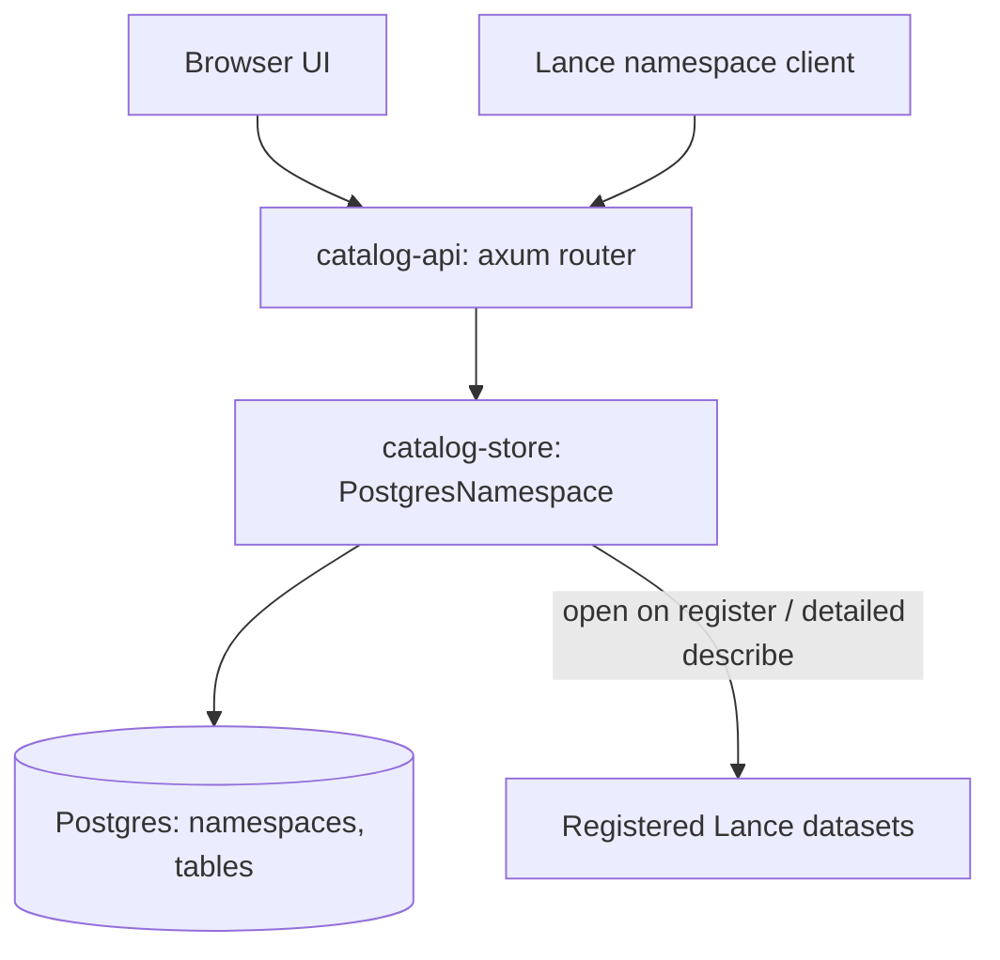

# Architecture

The catalog is an HMS-style [Lance REST catalog](https://lance.org/format/catalog/rest/):
Postgres stores namespaces and table registrations, and each registered Lance
dataset's manifest stays authoritative for its versions, schema, and stats.

## Crates

- `catalog-store` — `PostgresNamespace`, an implementation of
  `lance_namespace::LanceNamespace`, plus the sqlx migrations under
  `catalog-store/migrations/`.
- `catalog-api` — the `catalog-api` binary: config, Secret Manager credential
  hydration, the spec router, health routes, and static UI serving.

## Data model

- `namespaces(path text[] primary key, parent_path → namespaces ON DELETE RESTRICT, properties)`.
  The root namespace is implicit and has no row.
- `tables(namespace_path → namespaces ON DELETE RESTRICT, name, location, properties)`,
  primary key `(namespace_path, name)`.

Foreign keys make "parent must exist" and "drop only when empty" atomic under
concurrent requests; primary keys enforce unique names per parent. The owner is an
ordinary `owner` table property.

## Request handling

The upstream `RestAdapter` binds its own listener and keeps its router private,
so `catalog-api` owns an axum router that follows the adapter's conventions:

- Ids in the path are segments joined by `$`; `$` alone is the root namespace.
  A body `id` that disagrees with the path is rejected as invalid input.
- Errors are `{"error": ..., "code": ...}` with the spec `ErrorCode` and the
  adapter's status mapping (not found 404, exists / not empty 409, invalid 400,
  unsupported 406, internal 500).
- Spec routes the catalog does not implement return `Unsupported` (code 0, 406).

Supported operations: namespace list / describe / create / drop / exists; table
list / list-all / register / describe / exists / deregister.

- **Register** opens the location as a Lance dataset before inserting, so an
  unreadable URI never becomes a table.
- **Describe** reads Postgres only, unless `load_detailed_metadata` is set; then
  it opens the dataset and returns version, schema, and `stats`
  (`num_fragments`, `num_deleted_rows`).
- **Lists** never open datasets. Pagination uses an exclusive start-after name
  as `page_token`.
- **Deregister** deletes the catalog row only; source data is untouched.

Datasets are opened with storage options built from the `AWS_*` environment and
Secret Manager credentials. These are never returned to clients.

## Not implemented

Data operations, catalog-managed versions and commits, tags, branches, indexes,
transactions, rename/restore, credential vending, auxiliary datasets, and
machine-client authentication (the service sits behind platform IAP).

## Deployment

One Cloud Run container serves the API and UI on `$PORT`. With `enable_postgres`,
`docker-entrypoint.sh` starts the Cloud SQL Auth Proxy (IAM auth, private IP)
and derives `DATABASE_URL`; the server retries the initial connection, runs
migrations, and reports ready once the database answers. See
[the deploy runbook](docs/RUNBOOK-DEPLOY.md).
