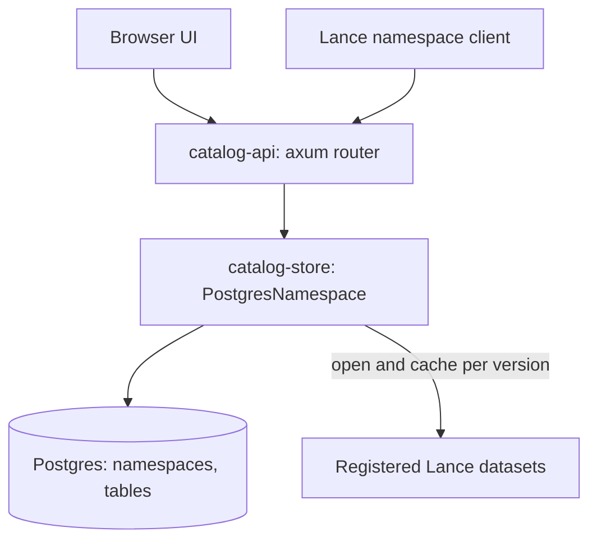

# Architecture

The catalog is an HMS-style [Lance REST catalog](https://lance.org/format/catalog/rest/):
Postgres stores namespaces, table registrations, and each table's current version;
each registered Lance dataset's manifest stays authoritative for the contents of
every version. Routes, configuration, and scope are in the [README](README.md).

## Crates

- `catalog-store`: `PostgresNamespace`, an implementation of
  `lance_namespace::LanceNamespace`, plus the sqlx migrations in
  `catalog-store/migrations/` and protos vendored from `lance-table` in
  `catalog-store/protos/` (used to decode a version's files).
- `catalog-api`: the `catalog-api` binary: config, Secret Manager credential
  hydration, the spec and catalog routers, health routes, and static UI serving.

## Data model

- `namespaces(path text[] primary key, parent_path → namespaces ON DELETE RESTRICT, properties)`.
  The root namespace is implicit and has no row.
- `tables(namespace_path → namespaces ON DELETE RESTRICT, name, location, properties,
  owner, description, current_version, current_e_tag, registered_at, updated_at)`,
  primary key `(namespace_path, name)`.

Foreign keys make "parent must exist" and "drop only when empty" atomic under
concurrent requests; primary keys enforce unique names per parent. On the wire,
owner and description are ordinary `owner` / `description` properties, and the
timestamps are the server-managed `catalog.registered_at` / `catalog.updated_at`
properties.

## Request handling

The upstream `RestAdapter` binds its own listener and keeps its router private,
so `catalog-api` owns an axum router that follows the adapter's conventions:
`$`-joined path ids, a body `id` that disagrees with the path rejected as invalid
input, and the adapter's status mapping for spec `ErrorCode`s (not found 404,
exists / not empty 409, invalid 400, unsupported 406, internal 500). Unmatched
routes under `/v1` and `/catalog/v1` return `Unsupported`.

The `/catalog/v1` router holds the operations no spec model carries: column
storage, storage footprint, fragment measures, timeline, version files, refresh,
and SQL.

## Current version and caching

Every read that names no version, on spec and catalog routes alike, answers for
the table's current version. Registration records the newest version and its
manifest e-tag; the refresh route or re-registration advances them. A commit
made directly to Lance does not become current until then. Each request reads
the current version from the table row, so every instance answers with the same
version. When the current version's files are gone (cleanup), the next read that
touches them advances it to the newest version with a compare-and-set, so
concurrent instances agree; a dataset with no manifest left returns
`TableNotFound` (404). Version lists, the timeline, tags, and branches stay live
and include versions newer than the current one; those are readable by number.
Cleanup commits no version, so it shows only as a gap in version numbers.

A Lance version never changes once written, so everything derived from one
version is cached per instance in the Lance session's metadata cache, keyed by
location, version, and manifest e-tag (the e-tag keeps a dataset recreated at the
same location from reusing old entries): opened datasets, the data statistics
shared by stats and column storage, fragment row counts, deleted-row counts, and
the storage listing. A warm instance answers repeat reads of the current version
without touching object storage. `CATALOG_CACHE_MEMORY_LIMIT_MB` bounds the
session (three quarters metadata, the rest index metadata) in place of Lance's
1 GiB and 6 GiB defaults; full caches evict by estimated size.

## SQL

The SQL route builds a fresh DataFusion session per query that exposes only the
addressed table: the plain table name reads the requested version (default:
current), and `"<name>@v<N>"` opens version N on demand, so one query can compare
versions. Planning runs with DDL, DML, and statements disabled and spilling off,
so a query cannot write anywhere; blob columns read as their descriptors, so
payload bytes are never fetched. Row, time, and memory limits bound each query
(the time limit covers opening every version), and a per-instance semaphore caps
concurrency.

## Storage footprint

Lance has no API for total storage size: the manifest summary and field
statistics cover only one version's data files, not blob v2 payload files
(`data/*.blob`), index files, or files retained for older versions. The storage
route therefore lists object metadata under the registered location, groups it
by category, and prices the total at `CATALOG_STORAGE_PRICE_PER_GB_MONTH`.

## Deployment

One Cloud Run container serves the API and UI on `$PORT`. The repo-root
`Dockerfile` builds the UI with Bun (`bun install --frozen-lockfile && bun run
build`), compiles the binary, and copies `dist/` to `/app/webui`
(`CATALOG_WEBUI_DIR`). The server serves it at `/` and falls back to `index.html`
for SPA deep links; the UI calls the API at the same origin, so no CORS is
needed. With `enable_postgres`, `docker-entrypoint.sh` starts the Cloud SQL Auth
Proxy (IAM auth, private IP) and derives `DATABASE_URL` and `CATALOG_DB_SCHEMA`;
the server retries the initial connection for 30 seconds, runs migrations, and
reports ready once the database answers. See
[the deploy runbook](docs/RUNBOOK-DEPLOY.md).
