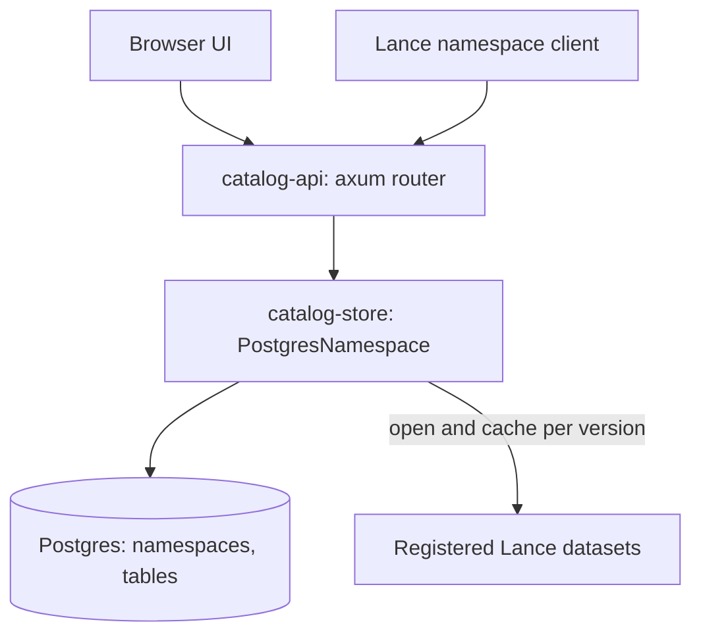

# Architecture

The catalog is an HMS-style [Lance REST catalog](https://lance.org/format/catalog/rest/):
Postgres stores namespaces, table registrations, and each table's served version
(the version reads that name no version answer for); each registered Lance
dataset's manifest stays authoritative for the contents of every version.

## Crates

- `catalog-store` — `PostgresNamespace`, an implementation of
  `lance_namespace::LanceNamespace`, plus the sqlx migrations under
  `catalog-store/migrations/`.
- `catalog-api` — the `catalog-api` binary: config, Secret Manager credential
  hydration, the spec router, health routes, and static UI serving.

## Data model

- `namespaces(path text[] primary key, parent_path → namespaces ON DELETE RESTRICT, properties)`.
  The root namespace is implicit and has no row.
- `tables(namespace_path → namespaces ON DELETE RESTRICT, name, location, properties,
  owner, description, served_version, served_e_tag, registered_at, updated_at)`,
  primary key `(namespace_path, name)`.

Foreign keys make "parent must exist" and "drop only when empty" atomic under
concurrent requests; primary keys enforce unique names per parent. On the wire,
owner and description are ordinary `owner` / `description` properties, and the
timestamps are server-managed `catalog.registered_at` / `catalog.updated_at`
properties (clients cannot set `catalog.*` keys). Overwrite re-registration
advances `updated_at` only.

## Request handling

The upstream `RestAdapter` binds its own listener and keeps its router private,
so `catalog-api` owns an axum router that follows the adapter's conventions:

- Ids in the path are segments joined by `$`; `$` alone is the root namespace.
  A body `id` that disagrees with the path is rejected as invalid input.
- Errors are `{"error": ..., "code": ...}` with the spec `ErrorCode` and the
  adapter's status mapping (not found 404, exists / not empty 409, invalid 400,
  unsupported 406, internal 500).
- Spec routes the catalog does not implement return `Unsupported` (code 0, 406).

Supported operations: namespace list / describe / create / drop / exists; table
list / list-all / register / describe / exists / deregister; read-only table
stats, version list / describe, index list / stats, tag list, branch list. Five
catalog routes sit outside `/v1` because no spec model carries their data or
operation: `GET /catalog/v1/table/:id/column-storage` (bytes per top-level
column of the served version), `GET /catalog/v1/table/:id/storage` (storage
footprint and cost estimate), `POST /catalog/v1/table/:id/refresh` (advance the
served version to the newest commit), `POST /catalog/v1/table/:id/sql`
(read-only SQL), and `GET /catalog/v1/table/:id/timeline` (per-version operation
history from each version's Lance transaction and manifest, read page by page).
Cleanup is not committed as a version, so the UI shows it only as a gap in
version numbers.

## Served version and caching

Every read that names no version, on spec and catalog routes alike, answers for
the table's served version. Registration records the newest version and its
manifest e-tag; the refresh route or re-registration advances them. A commit
made directly to Lance is therefore not served until then, and every instance
serves the same version because each request reads it from the table row. When
the served version's files are gone (cleanup), the next read that touches them
advances it to the newest version with a compare-and-set, so concurrent
instances agree. Version lists, the timeline, tags, and branches stay live and
include versions newer than the served one; those are readable by number.

A Lance version never changes once written, so everything derived from one
version is cached per instance in the Lance session's metadata cache, keyed by
location, version, and manifest e-tag: opened datasets, data statistics shared by
stats and column storage, fragment row counts, deleted-row counts, and the
storage listing of the served version. A warm instance answers repeat reads of
the served version without touching object storage. `CATALOG_CACHE_MEMORY_LIMIT_MB`
bounds the session (three quarters metadata, the rest index metadata) in place of
Lance's 1 GiB and 6 GiB defaults; full caches evict.

The SQL route builds a fresh DataFusion session per query and exposes only this
table: the plain table name reads the requested version (default: the served version), and
`"<name>@v<N>"` opens version N on demand, so one query can compare versions.
Planning runs with DDL, DML, and statements disabled and spilling off, so a
query cannot write anywhere. Each query is bounded by row, time, and memory
limits, and a per-instance semaphore caps concurrency.

Lance has no API for total storage size: the manifest summary and field
statistics cover only one version's data files, not blob v2 payload
files (`data/*.blob`), index files, or files retained for older versions. The
storage route therefore lists object metadata under the registered location,
groups it by category, and prices the total at
`CATALOG_STORAGE_PRICE_PER_GB_MONTH`.

- **Create namespace** at the top level accepts only the business verticals in
  `CATALOG_VERTICALS` when it is set, so the tree reads
  `<vertical>/<domain>/<table>`. Deeper levels are unrestricted, and existing
  top-level namespaces outside the list stay readable and droppable.
- **Register** opens the location as a Lance dataset before inserting, so an
  unreadable URI never becomes a table, and records its newest version as served.
- **Describe** reads Postgres only, unless `load_detailed_metadata` or a
  `version` is set; then it returns that version (default: the served version),
  schema, `stats`, and `metadata`: the version's manifest summary,
  `table_metadata.*` entries (Lance `Dataset::metadata`), `config.*` entries
  (Lance `Dataset::config`), and `lance.data_storage_version`.
- **Lance read routes** (stats, versions, indices, tags, branches, column
  storage) read the served version, or the requested one, through the cache.
  A dataset with no manifest left returns `TableNotFound` (404).
- **Lists** never open datasets. Pagination uses an exclusive start-after name
  as `page_token` (version number for version lists).
- **Deregister** deletes the catalog row only; source data is untouched.

The catalog only ever opens datasets for reading; its one write is the served version in Postgres.

Datasets are opened with storage options built from the `AWS_*` environment and
Secret Manager credentials. These are never returned to clients.

## Not implemented

Data operations, catalog-managed versions and commits, tag / branch / index
writes, transactions, rename/restore, credential vending, auxiliary datasets,
and machine-client authentication (the service sits behind platform IAP).

## Deployment

One Cloud Run container serves the API and UI on `$PORT`. With `enable_postgres`,
`docker-entrypoint.sh` starts the Cloud SQL Auth Proxy (IAM auth, private IP)
and derives `DATABASE_URL`; the server retries the initial connection, runs
migrations, and reports ready once the database answers. See
[the deploy runbook](docs/RUNBOOK-DEPLOY.md).
