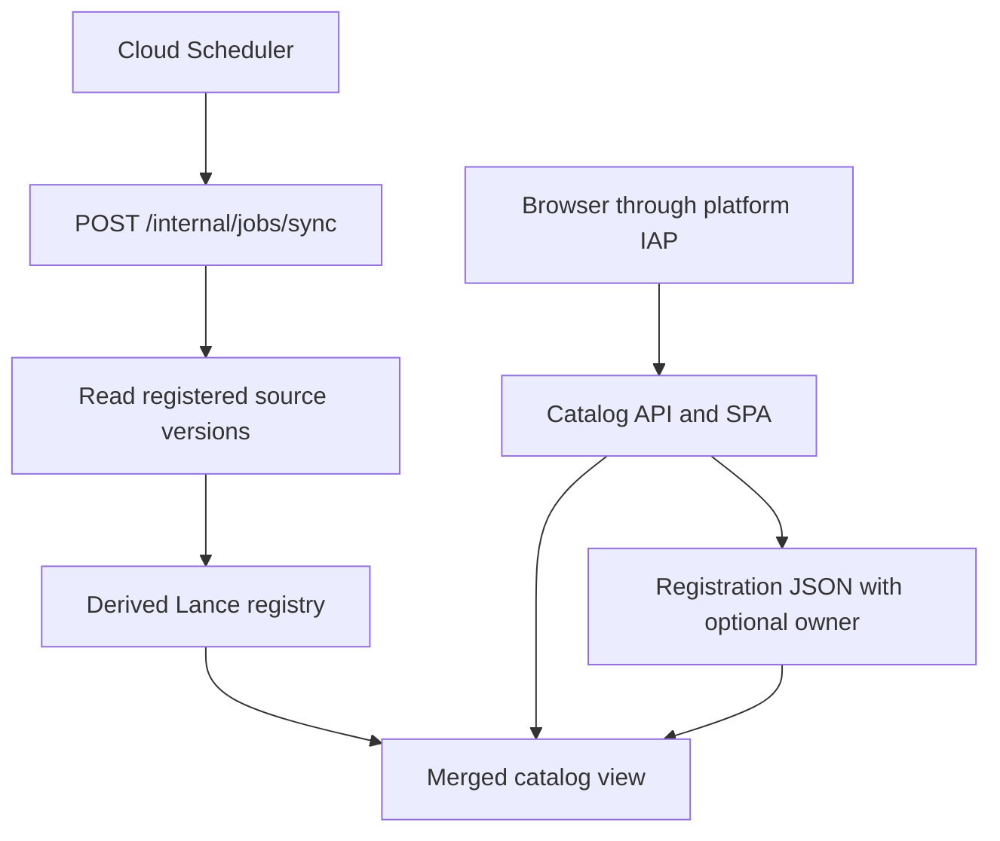

# Architecture (as-built)

This document describes the system as implemented. The broader long-term vision
lives in [`docs/design.md`](docs/design.md).

## Overview

One binary, `catalog-api`, serves the REST API and React SPA in a stateless
Cloud Run container. S3 stores catalog state. Any instance can serve a request;
there is no leader election or database. Cloud Scheduler triggers sync through
an HTTP endpoint because Cloud Run throttles CPU between requests.

## Regional deployment

The service is regional: one deployment per region, colocated with that
region's target buckets. The region, the target buckets, and each bucket's
registered namespaces are declared in `catalog-config.yaml` (committed,
baked into the image). Table ids are region-first composites
(`<region>:<bucket>:<namespace>:<name>`), so a future multi-region setup —
one deployment per region — can aggregate catalogs without id collisions.
Catalog state stays in the dedicated catalog bucket, never in target buckets.

## State model: derived vs authored

Each catalog version is one **immutable** timestamp directory
(`<table>/<ts>/dataset.lance/...`), never rewritten after export. That
immutability splits registry state in two:

1. **Derived state** — versions, shapes, byte splits, row counts, schemas, aux
   entries. A pure function of immutable S3 content, so any full sync
   regenerates it. The derived snapshot (`_catalog/registry`, a Lance dataset)
   is therefore written **whole, last-wins, with no coordination**: two
   concurrent syncs, or a Scheduler double-fire, cannot corrupt it — the worst
   case is bounded staleness until the next sync. Lost-update protection is
   meaningless for recomputable data.
2. **Authored state** — registration and optional per-table `owner`, stored as
   one JSON object at `_catalog/meta/<table_id>.json`. An empty object registers
   a table with no owner. Conditional writes use ETags to preserve concurrent
   owner updates.

The overlay also **defines the registered set**: the catalog is a curated
allowlist, not a mirror of the bucket. A table is registered iff an overlay
object exists for it (created by `DeclareTable`), and only registered tables are
synced. This is what lets a whole registered namespace serve a scoped catalog —
an operator registers the handful of tables to track, and unregistered tables
on S3 are never touched.

A read merges the snapshot with registration metadata into `TableEntry`
(`catalog-api/src/catalog.rs`). The snapshot supplies derived fields and the
registration supplies `owner`. A registered table not yet observed by sync is
materialized with an empty version list.

### The authored overlay (`MetaStore`)

`catalog-store/src/overlay.rs` is the CAS primitive. `mutate_meta(id, f)` reads
the overlay object (or starts fresh if absent), applies the caller's closure,
then writes with `PutMode::Update` pinned to the observed ETag (or
`PutMode::Create` if it was absent). If another writer committed in between, the
store returns `Precondition`/`AlreadyExists`; the read-modify-write retries on
the fresh state, bounded by a retry ceiling. At the catalog's admin write volume
contention is effectively never, but the retry makes it correct regardless.

> `object_store`'s `LocalFileSystem` does not implement `PutMode::Update`, so the
> overlay must be backed by S3 / a MinIO-compatible endpoint (production, local
> dev) or `InMemory` (tests). The sync/data path still uses `LocalFileSystem`
> freely — it does no conditional writes.

## The sync

`catalog-store/src/sync.rs` classifies one table's directory
(`sync_table`). `catalog-api/src/sync.rs` wraps it into one request-scoped
pass: `run_sync` reads registration objects, derives registered tables' version
sets from S3, writes the snapshot, and best-effort prunes old registry manifest
versions. It does not scan bucket roots or unregistered tables.

### Multi-bucket sync targets

`catalog-config.yaml` declares the buckets and, per bucket, the registered
namespace prefixes; there is no discovery of namespaces from S3 — a namespace
becomes syncable only by being listed in the config. Each `(bucket, namespace)`
pair becomes one `SyncTarget`, sharing one object store per bucket. Each
registered table's version directories are listed directly. All targets feed
one bounded version queue.

### Execution shape (performance)

Syncing is S3-latency-bound, so the implementation minimizes round-trips and
maximizes useful concurrency:

- **One recursive LIST per version.** A version's shape, byte splits (lance-core/
  sidecar/segments/other-aux), aux entries, format detection, and fingerprint are
  all derived in memory from a single recursive LIST of its timestamp directory
  (`catalog-store/src/format.rs` helpers are pure functions over that object
  list). The only other per-version IO is opening the main Lance dataset.
- **Manifest-first Lance stats.** The one manifest the open fetches is milked for
  everything it carries: row count (Σ per-fragment counts — `count_rows()`, which
  can read deletion files, runs only as a fallback when a fragment's count is
  unknown), fragment count, schema, the lance manifest version, and the writer
  version. `load_indices` (extra index-metadata IO) is gated by
  `CATALOG_SYNC_DEEP_STATS` (`all`/`latest`/`none`); the open itself always runs,
  so shape/`partial` classification is identical in every mode. The sync report
  includes cumulative LIST time, Lance-open time, and objects listed.
- **The unit of work is the version, not the table.** All registered tables'
  version dirs are discovered first (one delimiter LIST per table, concurrently),
  then every pending version from every table feeds one global
  `buffer_unordered(CATALOG_SYNC_CONCURRENCY)` queue — so a 500-version table
  interleaves with 3-version tables instead of serializing behind them, and wall
  time ≈ `pending versions / concurrency`.
- **Carry-forward.** Versions are immutable timestamp dirs, so a version already
  in the prior snapshot with a clean (non-partial) classification is copied
  forward without re-reading their objects. New and partial versions are synced.
  Carry-forward assumes timestamp directories are immutable: changing an
  already-clean version in place can leave its stats stale.
- **Incremental publication.** As each table's last pending version lands, the
  snapshot is rewritten (throttled to a few seconds apart, plus a final
  unconditional write) — a long first sync fills the catalog table-by-table
  rather than all-or-nothing, and a crash/timeout keeps everything completed so
  far.

Because the snapshot is rebuilt from the registered set each pass, it stays an
allowlist automatically: a deregistered table (overlay deleted) is simply not
synced and drops out of the snapshot. A version no longer present on S3 is
removed from the freshly derived version set.
A registered table with no directory on S3 yet syncs cleanly to zero versions (a
stub) until data lands.

A single registered table failing to sync is isolated — logged, counted, and
kept from the prior snapshot — rather than aborting the whole cycle and stalling
every other table's freshness. Partial versions are re-derived on later syncs,
so transient dataset-open failures can recover.

**Idempotent under double-fire.** The `/internal/jobs/sync` endpoint serializes
syncs on a single instance with an in-process mutex (so a Scheduler double-fire
doesn't run two at once on the same instance); cross-instance concurrency is safe
regardless because the snapshot is last-wins.

### Version discovery

For each registered table the sync lists that table's directory
(`<root>/<table_id>/`) for timestamp subdirectories. A timestamp directory name
is parsed as `YYYY-MM-DD_HH-MM-SS` or `YYYY-MM-DD-HH-MM-SS` (name variance is
handled), normalized to an ISO8601 version id. One timestamp directory = one
catalog version. Every timestamp version from earliest to latest is supported,
regardless of pre/post cutoff layout.

### Shape classification

Each timestamp directory is classified into one of five shapes:

- `full` — a main lance directory (openable as a Lance dataset) + `segments/`
  [+ `dataset.sidecar/`].
- `lance_only` — main lance present, no `segments/`.
- `seg_only` — `segments/` only, no main lance (partial; cannot open, aux only).
- `lance_only_partial` — the apparent main lance directory contains only nested
  lances (`index_datasets/`, `tag_datasets/`) with no `_versions/`+
  `_transactions/` at its own root (partial).
- `empty` — no recognized directories.

A `partial` flag is set on any version whose shape is not `full`.

### Main lance detection

The main lance directory is detected by the presence of `_versions/` and
`_transactions/` at the directory root, never by name. The name varies in
practice (`dataset.lance/` for most tables, `dataset/` for some). If a candidate
directory lacks `_versions/`+`_transactions/` at its root and contains only
nested lances, the version is `lance_only_partial`.

### Size split

Storage bytes are attributed per-component so that pre-cutoff versions (where
sidecar directories live inside `dataset.lance/` and inflate its size) are
correctly decomposed:

- `lance_core_bytes` — `_versions/`, `_transactions/`, `_indices/`, `data/`.
- `sidecar_bytes` — sidecar directories, wherever located (top-level
  `dataset.sidecar/` if present, else the known sidecar subdirs inside the main
  lance dir).
- `segments_bytes` — the `segments/` directory.
- `other_aux_bytes` — any other top-level aux directory not accounted for above.

`storage_bytes_total` is the logical, deduplicated sum of these components,
not a complete physical bucket footprint. During the dual-write transition,
top-level sidecar content wins over duplicate content inside the main dataset.

### Auxiliary tables (sidecar / nested sidecar)

Aux entries carry a placement taxonomy: **`sidecar`** for top-level aux
(`dataset.sidecar/`, `segments/`, known top dirs) and **`nested_sidecar`** for
aux living inside the main lance dir. Every nested lance dataset root (a dir
with `_versions/`, at any depth — e.g.
`dataset.lance/tag_datasets/<n>.lance/.../segment_tags.lance`) is discovered
from the version's single object LIST at zero extra request cost: an existing
aux entry whose path is a root is enriched in place, and deeper roots become
their own entries named by relative path, with `dataset_path` pointing at the
openable root. Lance aux entries get manifest-derived `row_count`/schema/writer
stats (deep-stats-gated, manifest-only — no index loads). A version whose main
lance dir holds only nested datasets stays `partial` (primary missing). The
sample endpoint reads rows through `dataset_path` (lance) or the entry path
(parquet, via DataFusion) — strictly read-only, clamped, and timeout-bounded.

### Aux format detection

Aux directories (`segments/`, `dataset.sidecar/`, `curated_csv/`, `row_counts/`,
nested lances, etc.) are recorded as `AuxEntry`s with a detected `format`:

- `parquet` — `_SUCCESS` + `part-*.parquet`.
- `lance` — `_versions/` + `_transactions/`.
- `csv` — `*.csv`.
- `mixed` / `unknown` — otherwise, with a fingerprint via LIST.

Aux names are not hardcoded beyond the sidecar/segments/lance-core sets; the dir
name is recorded as the `role`.

### Pre+post 2026-06-26 cutoff aux layout

A layout transition occurred around 2026-06-26:

- **Pre-cutoff** (< 2026-06-26): sidecar directories live *inside*
  `dataset.lance/` (alongside lance-core directories). The sync reads them from
  there.
- **Post-cutoff** (>= 2026-06-26): sidecar directories move to a top-level
  `dataset.sidecar/`; `dataset.lance/` is clean (lance-core only).
- **Transition** (~2026-06-12): sidecar content is duplicated both inside
  `dataset.lance/` and at top-level `dataset.sidecar/` (dual-write). The sync
  deduplicates: when a top-level `dataset.sidecar/` is present it is preferred;
  otherwise sidecar bytes are read from inside the main lance dir.

The sync supports both layouts so the full version history is cataloged
correctly. The real-world layout is captured in
[`docs/design.md`](docs/design.md), including concrete annotated example tables.

## The registry (derived snapshot)

The registry is a Lance dataset under `_catalog/registry` (path configurable via
`CATALOG_REGISTRY_PATH`). It stores one derived `TableEntry` per table: id
(the region:bucket:namespace:name composite), name, region, bucket, namespace,
root_location, last_synced, versions[], and aux_latest[]. The sync leaves the
owner slot empty and the read view fills it from registration metadata. Version
records contain timestamps, paths, shape/partial status, byte totals, object
and row counts, schema, fragment/index counts, Lance/writer versions, auxiliaries,
and sync time.

Persisted JSON types default additive fields and ignore unknown fields. Existing
snapshots and registrations containing retired feature fields remain readable.
New snapshots omit those fields. The sync tail-calls Lance `cleanup_old_versions` on
the registry so its manifest history does not grow unbounded (each sync adds one
version).

Registry reads fail closed: `read_registry` returns `Ok(None)` only for a
genuinely absent dataset (first boot); any other read failure is an `Err`.

## The read model (merged view)

`catalog-api/src/catalog.rs` holds the merged read model, shared across handlers.
It reads the snapshot + all overlays and merges them into the `TableEntry` wire
shape. Because Cloud Run throttles CPU between requests, there is no background
refresh loop: the view is revalidated **lazily** — re-read from storage when
older than `CATALOG_CACHE_TTL_SECS` (default 5s), single-flighted so a burst of
stale reads triggers one reload — and immediately after a mutation invalidates it
(read-your-writes on the same instance). On a revalidation error the last good
view is retained; repeated storage failures can leave it stale indefinitely.
`/readyz` reports ready once the view has loaded at least once.

Mutations re-fetch the overlay fresh inside every write (the cache is for reads
only): a handler calls `MetaStore::mutate_meta`, then invalidates the read cache.

## Startup and shutdown

At startup the process fetches AWS credentials from Secret Manager (see
[Credentials](#credentials)), builds the sync + overlay object stores, and binds
one HTTP server on the single port (`PORT` on Cloud Run, else
`CATALOG_BIND_ADDR`). The server drains in-flight requests on `SIGTERM`/Ctrl-C via
graceful shutdown before the process exits. Duration config values (`*_SECS`) are
validated at load: a set-but-unparseable value or `0` is a hard startup error,
not a silent fallback.

## Credentials

Cloud Run runs under a *GCP* service account, but the catalog's data is in *AWS*
S3, so there is no ambient AWS credential. The operator stores the AWS keys as
app secrets; the platform lands them in Secret Manager as
`<service>-aws-access-key-id` etc. and does **not** inject them as env vars, so
`catalog-api/src/secrets.rs` reads them at runtime (metadata-server access token
→ Secret Manager REST) and passes them to the `object_store` S3 builder. Locally
(and in tests) there is no metadata server: if `AWS_ACCESS_KEY_ID` is already in
the environment, or no service-name prefix is set, this is a no-op and the
env-based path (including a MinIO endpoint) is used unchanged. Non-secret S3
config (region, endpoint) travels as plain `[cloudrun].env_vars`.

## REST API surface

See [README.md](README.md#rest-api-surface) for the route list. The
authoritative source is `catalog-api/src/api.rs::api_router`.

- **Basic ops** (`/v1`): namespace and table listing/description, idempotent
  registration with optional owner, and deregistration without deleting source
  objects. Namespaces are derived from catalog entries.
- **Enriched reads** (`/ext/v1`): full table entries, version details, and
  bounded auxiliary samples. The table listing has no server pagination.
- Any instance serves any request; there is no leader-only 503.

## Frontend

`frontend/` is a React + Vite + TypeScript SPA. TanStack Router manages routes,
Query manages server data, and Table handles client-side listing. Zod validates
API response shapes. Tables, namespaces, versions, schemas, and auxiliary
samples share the API's origin. The container builds `dist/` and the API serves
it from `CATALOG_WEBUI_DIR`.

## Observability

Structured JSON logs go to stdout for Cloud Logging: sync summaries and
per-table failures. HTTP request/latency metrics come from Cloud Run's built-in
Cloud Monitoring; there is no Prometheus endpoint or scrape. Log-based metrics
and alerts can be layered on in Cloud Monitoring later.

## Notable behaviors and limitations

- **Snapshot last-wins can write an older sync over a newer one.** Bounded by
  the sync cadence and self-healing on the next sync; acceptable for
  recomputable derived state.
- **App-level auth is delegated to the platform.** IAP + Trident authorize human
  requests (`allowed_usergroups`); the Cloud Scheduler service account reaches
  `/internal/jobs/sync` via its platform identity. The app does no auth of its
  own.
- **`/ext/v1/tables` has no pagination.** Fine at admin scale (dozens of tables).
- **Design features not implemented:** lineage, MCP, Flight SQL, profiling,
  maintenance/compaction, cost analysis, credential vending, operation history,
  inbox. See [`docs/design.md`](docs/design.md).
