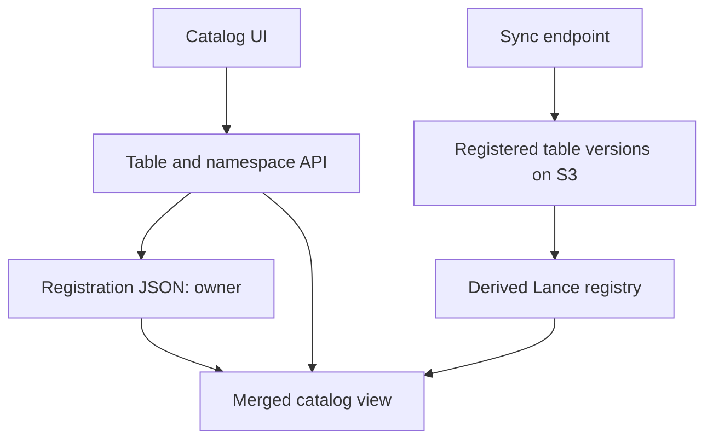

# Catalog Inventory Simplification - Plan

## Goal Capsule

- Objective: Operators can register and inspect Lance tables without unrelated lifecycle, bucket exploration, or user-management features.
- Means: Remove the unused feature surfaces and their state, retaining the existing registration and pull-sync workflow.
- Authority: The user's requested removals and direct-main delivery govern. Repository safety and verification rules remain mandatory.
- Execution profile: One coherent change, verified locally and committed and pushed directly to main as explicitly requested. No live deployment or stored-data deletion.
- Stop conditions: Do not publish failed checks, corrupt existing registration data, weaken platform access controls, or lose retained table metadata.

---
## Product Contract

### Summary

Keep a curated Lance table inventory: registration, namespace/table/version browsing, per-version stats, auxiliary metadata and sampling, and scheduled or manual pull sync.
Remove TTL, bucket overview, and in-app identity features across the backend, UI, config, tests, and current docs.

### Problem Frame

The catalog currently carries lifecycle and user-management state that is unrelated to the inventory workflow.
Obsolete TTL state and bucket-wide scans complicate registration, reads, sync, and the UI.

### Requirements

**Feature removal**
- R1. Remove TTL policies, protection, dry-run, apply, audit, delete helpers, and version deletion markers.
- R2. Remove bucket storage overview, storage scan persistence, and sync's storage-analysis tail; retain table/version size stats.
- R3. Remove identity middleware, users persistence, identity endpoints, role/admin configuration, and identity UI.

**Retained workflow**
- R4. Preserve table registration, owners, deregistration without deleting source data, configured region/bucket/namespace validation, browsing, stats, and auxiliary sampling.
- R5. Existing registry snapshots and registration JSON containing removed fields must still load; only retired feature state may be ignored.
- R6. Simplifications preserve retained outputs, errors, side effects, and ordering. Do not add speculative caching, indexes, concurrency layers, retries, or abstractions.
- R7. Preserve platform IAP/access boundaries and credential loading for object-store access.

### Key Decisions

- **Remove application identity, not platform access control.** Removing access control could expose source data. Governs R3, R7. (session-settled: user-approved — chosen over disabling IAP and credentials: remove catalog features without exposing the service or breaking S3 access)

### Scope Boundaries

No live object-store changes, migrations, deployment, new auth implementation, new query interface, generalized performance redesign, or automatic table discovery.
Historical planning documents remain historical; current docs must identify the supported surface accurately.

---
## Planning Contract

### Key Technical Decisions

- KTD1. Delete removed modules and routes rather than keeping disabled endpoints or compatibility aliases. Existing serde readers ignore removed JSON keys.
- KTD2. Keep the per-table registration objects and owner writes distinct from the derived registry. An empty object still registers a table; do not equate owner absence with deregistration.
- KTD3. Remove the registry TTL column from new snapshots; the reader must tolerate older snapshots with that extra column. Do not rewrite stored datasets as an operational prerequisite.
- KTD4. Preserve current bounded sync concurrency and immutable-version carry-forward. Simplify TTL-only conditions and reconciliation rather than replacing working IO behavior with speculative optimizations.
- KTD5. Reuse existing count formatting and table accessor results. Remove the unused frontend deregistration client only, leaving the server API intact.

### Assumptions

The remaining owner field is descriptive table metadata, not identity/auth infrastructure.
Platform IAP stays configured outside the app. No runtime or source-data deletion is authorized.
Old persisted TTL/protection fields may be ignored because those capabilities are explicitly removed.

### High-Level Technical Design

---
## Implementation Units

### U1. Remove retired backend capabilities

**Goal:** Backend exposes only inventory functionality and reads older persisted catalog state safely.
**Requirements:** R1-R7; KTD1-KTD4.
**Dependencies:** None.
**Files:** `catalog-core/src/`, `catalog-core/tests/registry_test.rs`, `catalog-store/src/`, `catalog-store/tests/sync_test.rs`, `catalog-api/src/`, `catalog-api/tests/api_test.rs`, `catalog-api/tests/run_sync_test.rs`, crate manifests if dependencies become unused.
**Approach:** Remove retired types/modules/routes/config and their tests; trim state constructors and callers; simplify overlay merge and carry-forward conditions. Keep namespace validation, missing-object/error handling, size/shape calculations, and source-data read-only behavior unchanged.
**Patterns:** Existing registry round-trip tests, in-memory registration store, filesystem sync fixtures, API router integration tests.
**Execution note:** Update the API contract test for retired endpoints before removing routes. Retain or add persistence compatibility coverage at the owning reader seam.
**Test scenarios:**
1. Retired API paths return 404; retained registration and describe paths still work without caller identity.
2. A registration with no owner remains registered before and after sync.
3. Older registration JSON and registry JSON containing policy/protection keys load retained owner/version data.
4. Existing sync scenarios for allowlisting, missing/deleted versions, failure isolation, and auxiliary stats remain valid.
**Verification:** Workspace build, tests, formatting, and clippy pass on the integrated result.

### U2. Remove retired frontend surfaces

**Goal:** UI presents only table inventory and inspection.
**Requirements:** R1-R4, R6; KTD5.
**Dependencies:** Shared retained wire contract is established by this plan; authoring can run with U1 under separate file ownership.
**Files:** `frontend/src/`, excluding hand edits to `frontend/src/routeTree.gen.ts`; `frontend/package.json` only if unused dependencies can be removed safely.
**Approach:** Remove storage page, identity badge, TTL panel, policy fields, and protection controls. Remove corresponding client methods and schemas. Regenerate routes through the existing build tooling. Reuse count formatting and accessor values in retained UI paths.
**Patterns:** Existing table/namespace/version pages and runtime schema validation.
**Test scenarios:**
1. Registration accepts table id and optional owner without policy controls.
2. Table and version pages render stats, schema, and auxiliaries without identity/protection/TTL requests.
3. Removed storage navigation and route are absent.
4. Existing schema compatibility and formatter behavior remain covered; strengthen the fractional GiB rounding assertion.
**Verification:** Frontend typecheck, tests, and build pass. Inspect actual browser surfaces at desktop and mobile widths using local fixture data.

### U3. Align current documentation and deployment config

**Goal:** Operators see an accurate description of the reduced catalog.
**Requirements:** R1-R7.
**Dependencies:** U1 and U2.
**Files:** `README.md`, `ARCHITECTURE.md`, `docs/RUNBOOK-DEPLOY.md`, `docs/RUNBOOK-TTL.md`, `docs/RELEASE-v1.0.0.md`, `docs/FRONTEND.md`, `catalog-config.yaml`, `project.toml`, deployment container config where retired env vars occur.
**Approach:** Document the supported routes and pull freshness model; remove obsolete TTL runbook and current operational instructions for retired datasets. Mark long-term design/historical notes as non-authoritative rather than rewriting design history. Preserve platform access and credential instructions.
**Test expectation:** No new permanent tests for prose/config deletion; integrated runtime and check results prove retained behavior.
**Verification:** Current config loads without admins and retired env vars. No executable caller or current operational instruction requires removed features.

---
## Verification Contract

- Rust: `cargo build --workspace`, `cargo test --workspace`, `cargo fmt --all -- --check`, and `cargo clippy --workspace --all-targets -- -D warnings`.
- Frontend: `bun --bun run typecheck`, `bun --bun run test`, and `bun --bun run build`; no frontend lint script is configured.
- Runtime: Browse retained routes with deterministic local fixture responses at desktop/mobile widths, exercise registration, and inspect errors/requests.
- Publication: Review the actual change, apply evidenced mechanical fixes, then commit and push only owned paths to main without force. No deployment.

---
## Definition of Done

Retired backend/UI/state/config are removed without shims.
Retained catalog workflow and persisted data compatibility are verified.
Current docs match implementation; no abandoned scaffolds remain.
Changes are reviewed, committed, and pushed directly to main, or a concrete verification/publication blocker is reported.
