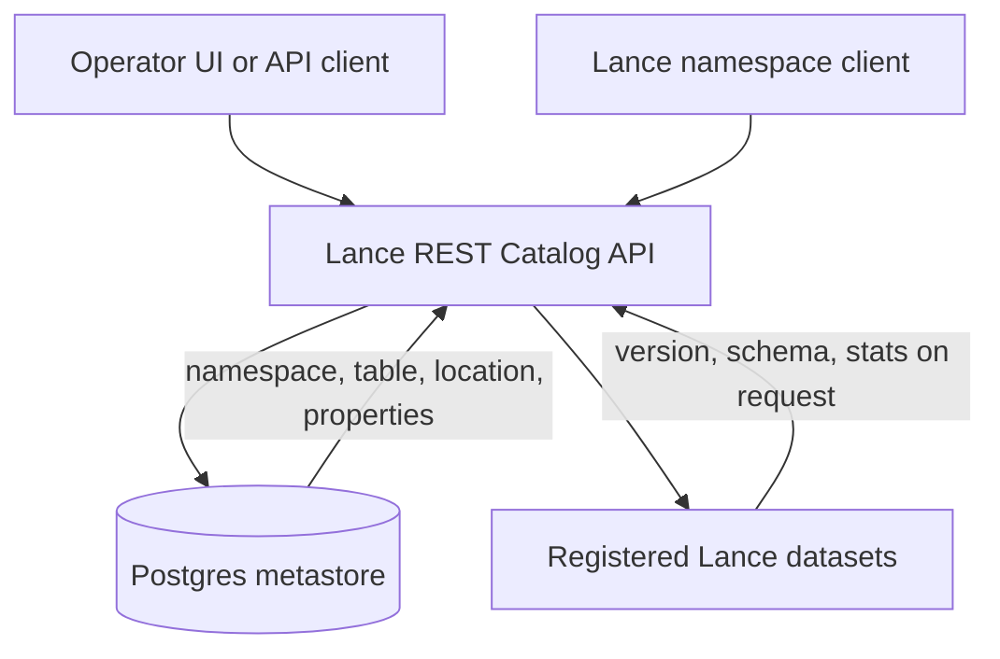

# Postgres Lance REST Catalog - Plan

## Goal Capsule

- **Objective:** Operators can organize Lance datasets into namespaces and register them by URI in a catalog that standard Lance namespace clients can use without a custom integration.
- **Means:** Replace the S3-only inventory backend with a Postgres-backed server that implements the Lance REST Catalog's core metadata operations.
- **Product authority:** This Product Contract. The Lance Namespace and REST Catalog specifications govern wire behavior where this contract adopts them.
- **Open blockers:** None.

---

## Product Contract

### Summary

The catalog becomes an HMS-style Lance REST catalog backed by Postgres. Operators create nested namespaces and register existing Lance datasets by URI. The catalog stores table identity, location, and properties, while each Lance manifest remains authoritative for versions, schema, and stats. The UI is rebuilt on the same spec routes.

### Problem Frame

The current catalog is an inventory service. It stores registrations as per-table JSON in object storage, derives a Lance registry snapshot through scheduled sync, and exposes a hand-written API. That API is not the Lance REST Catalog route set, so engines and Lance namespace clients cannot use the catalog directly.

Its table model also differs from Lance. One cataloged table is a folder of timestamp snapshots, each a separate Lance dataset, and the catalog presents those folders as versions. Lance treats a table as one dataset location whose versions are recorded in its manifest. Engines need the standard model before they can integrate later, and operators need a reliable way to register tables now.

### Actors

- A1. **Operator:** creates namespaces, registers or deregisters tables by URI, and browses the catalog through the UI or API.
- A2. **Lance namespace client:** an engine, SDK, or tool that resolves names and table locations through the standard REST routes. Production engine connectivity is deferred; the API contract must still support it.
- A3. **Catalog service:** persists namespace and table metadata in Postgres and reads Lance manifests to return details on demand.

### Key Decisions

- **Use Postgres as the HMS-style metastore.** Its transactions support unique names, restricted drops, and future commit coordination. Governs R1, R3, R4. (session-settled: user-directed — chosen over upstream Directory V2 on object storage: preferred a relational metastore despite the extra database operations)
- **Implement the minimal metadata catalog.** Data operations and catalog-managed versions wait until engines integrate. Governs R12, R13. (session-settled: user-directed — chosen over adding external manifest-store commits or adopting Apache Gravitino: smallest build that delivers spec-conformant registration)
- **A table is one Lance dataset location.** Timestamp snapshot folders are no longer modeled as versions; each snapshot needed is registered separately. Governs R5, R8. (session-settled: user-directed — chosen over timestamp-folder roots or a latest-snapshot alias: conforms to the Lance table model)
- **Namespaces are catalog-managed.** A table's namespace path is independent of its storage location. Governs R2-R4, R6. (session-settled: user-directed — chosen over restricting URIs to configured roots or deriving namespaces from config: matches the specification and HMS)
- **Read details on demand.** Table details come from the Lance manifest when requested, and scheduled stats sync is removed. Governs R8, R9, R16. (session-settled: user-directed — chosen over cached Postgres stats or deferring stats: simplest and always current)
- **Defer auxiliary datasets.** The catalog handles ordinary Lance tables only. Governs R16. (session-settled: user-directed — chosen over parent-directory discovery, explicit registration, or nested-only discovery: keep a canonical Lance catalog)
- **Start fresh.** Existing catalog objects are not migrated; operators register the datasets they need again. Governs R17. (session-settled: user-directed — chosen over importing latest or all timestamp snapshots: existing records do not map to the new table model)
- **Rebuild the UI on spec routes.** The UI remains an operator surface while the old API contract is removed. Governs R15, R16. (session-settled: user-directed — chosen over API-only delivery: operators keep a browsing and registration workflow)

### Requirements

**Metastore and namespaces**

- R1. Postgres is the source of truth for catalog namespaces, table identifiers, locations, and table properties.
- R2. Operators can create, list, describe, and check namespaces at any depth below the root namespace.
- R3. Dropping a namespace succeeds only when it contains no child namespaces or tables.
- R4. Namespace and table names are unique within their parent namespace.

**Table registration and lookup**

- R5. Operators can register an existing Lance dataset under a namespace by providing its storage URI.
- R6. Registration requires the parent namespace to exist and fails if the identifier is already registered.
- R7. Registration rejects URIs that the catalog cannot open as Lance datasets.
- R8. Describing a table returns its location and properties, and returns current version, schema, and stats when detailed metadata is requested.
- R9. Table and namespace listings return identifiers, locations, and properties without opening every dataset.
- R10. Deregistering a table removes only catalog metadata; source data is never deleted.
- R11. The table owner, when provided, is stored as an ordinary table property.

**Specification conformance**

- R12. The API implements the Lance REST Catalog routes and models for the recommended metadata operations plus RegisterTable, NamespaceExists, TableExists, and ListAllTables.
- R13. Operations outside R12 return the specification's Unsupported error rather than a custom or partial behavior.
- R14. Spec-conformant responses use the specification's error model and status mapping for the supported operations.

**Operator UI and replacement**

- R15. The UI supports namespace browsing, namespace creation and restricted deletion, URI registration, deregistration, and table details using only the supported spec operations.
- R16. Current non-spec catalog routes, composite table identifiers, scheduled sync, and auxiliary dataset views are removed.
- R17. Existing S3 registrations and registry snapshots are left in place but are neither read nor migrated by the new catalog.

### Acceptance Examples

- AE1. **Covers R2, R6.**
  - **Given:** namespace `prod` exists, but `prod.analytics` does not.
  - **When:** an operator registers table `prod.analytics.users`.
  - **Then:** registration fails with a namespace-not-found error and creates no namespace or table.
- AE2. **Covers R5, R7, R8.**
  - **Given:** an existing readable Lance dataset at an S3 URI.
  - **When:** an operator registers it as `prod.users`, then requests detailed metadata.
  - **Then:** the catalog returns the registered location and the dataset's current version, schema, and stats.
- AE3. **Covers R7.**
  - **Given:** a URI that does not contain a readable Lance dataset.
  - **When:** an operator attempts registration.
  - **Then:** registration fails and no table entry is created.
- AE4. **Covers R3.**
  - **Given:** namespace `prod` contains a registered table.
  - **When:** an operator drops `prod`.
  - **Then:** the drop is rejected and the namespace and table remain.
- AE5. **Covers R10.**
  - **Given:** `prod.users` is registered.
  - **When:** an operator deregisters it.
  - **Then:** the table disappears from catalog listings and its dataset remains readable at the original URI.
- AE6. **Covers R13.**
  - **Given:** a client calls a data or version-management operation.
  - **When:** the catalog receives the request.
  - **Then:** it returns the specification's Unsupported error.

### Success Criteria

- A standard Lance namespace REST client can create a namespace, register an existing dataset, list it, and describe its location using the specification's request and response shapes.
- An operator can complete namespace creation, URI registration, table detail inspection, and deregistration through the UI.

### Scope Boundaries

**Deferred for later**

- Production engine and machine-client authentication; the service remains behind browser-oriented platform IAP.
- Data operations, including create from Arrow data, query, insert, update, delete, and merge.
- Catalog-managed table versions and commit coordination.
- Tags, branches, indexes, transactions, rename, restore, and schema alteration.
- Credential vending through `storage_options`.
- Auxiliary dataset discovery, browsing, and sampling.
- Bulk import of previous catalog entries.

**Outside this product's identity**

- A timestamp-folder snapshot inventory that treats folders as table versions.
- Scheduled stats ingestion or a cached derived-stats registry.

### Dependencies / Assumptions

- Apps Platform can provide and connect a Postgres database for the deployed service.
- The catalog service has object-store credentials for URIs it validates and describes.
- The current Lance namespace libraries require a major Lance upgrade from the repository's current Lance version.
- `docs/design.md` and current architecture documents will be updated where they say Postgres is rejected or S3 is the sole catalog store.

### Outstanding Questions

None. Planning resolved the deferred questions in the Key Technical Decisions below.

### Sources / Research

- Lance REST Catalog specification: https://lance.org/format/catalog/rest/
- Lance Namespace specification: https://lance.org/format/namespace/
- Current API routes: `catalog-api/src/api.rs`
- Current registration storage: `catalog-store/src/overlay.rs`
- Current composite table identifiers: `catalog-core/src/table_id.rs`
- Current frontend API client: `frontend/src/lib/api.ts`
- Prior storage principle to supersede: `docs/design.md`
- Current deployment settings: `project.toml`
- Upstream namespace crates: `lance-namespace` 14.0.2 (`LanceNamespace` trait, spec models), `lance-namespace-impls` 14.0.2 (`rest_adapter.rs` route, id-parsing, and error-mapping conventions)

---

## Planning Contract

### Key Technical Decisions

- **KTD1. Implement `lance_namespace::LanceNamespace` backed by Postgres; serve it through a project-owned axum router.** The upstream `RestAdapter` router is private and binds its own listener, so it cannot share the single Cloud Run port with the UI and health routes. The project router mirrors the adapter's route paths, `$` id delimiter, body/route id reconciliation, and `ErrorCode`-to-status mapping for the supported operations. Every other `/v1/` spec route returns `ErrorResponse{code: 0}` with HTTP 406 (R13).
- **KTD2. Target `lance` / `lance-namespace` 14.0.2.** The models match the current spec. Most code that reads Lance (sync, aux sampling, DataFusion) is deleted, so the upgrade only affects opening datasets. The toolchain pin (1.94) already satisfies `rust-version`.
- **KTD3. Use `sqlx` (postgres, tokio, runtime-checked queries) with embedded migrations.** Builds need no database. Namespaces are keyed by `path text[]`, with `parent_path` referencing `namespaces(path) ON DELETE RESTRICT`. Tables use `(namespace_path, name)` as the primary key, with `namespace_path` referencing namespaces and `ON DELETE RESTRICT`. Foreign keys enforce R3/R6 atomically under concurrency, and unique keys enforce R4. The root namespace is implicit and has no row.
- **KTD4. Credentials come from the existing `AWS_*` env and Secret Manager hydration.** They become Lance `storage_options` and are used only server-side. `storage_options` is never returned to clients because vending is deferred.
- **KTD5. Database connection.** Use `DATABASE_URL` locally and in CI. On Cloud Run (`enable_postgres = true`), the container entrypoint starts the Cloud SQL Auth Proxy with `--auto-iam-authn --private-ip` when `INSTANCE_CONNECTION_NAME` is set. The app then connects to `127.0.0.1:5432` as `DB_USER`/`DB_NAME`, and migrations run in the service schema (`search_path`). Deployed connectivity cannot be verified in this run.
- **KTD6. Remove the `catalog-core` crate and the regional `catalog-config.yaml`.** Bucket and namespace config, composite ids, sync, TTL, overlay, identity users table, and `/ext` routes go away (R16). The workspace becomes `catalog-store` (Postgres namespace impl and migrations) plus `catalog-api` (HTTP, UI serving, bootstrap).
- **KTD7. Database tests read `CATALOG_TEST_DATABASE_URL`, and each test uses its own schema.** When the variable is unset, tests print a skip notice. CI runs a Postgres service and sets `CATALOG_REQUIRE_DB_TESTS=1`, which turns a missing URL into a failure.
- **KTD8. UI ids.** Spec ids travel as `$`-joined path segments. The UI displays dotted names and builds route ids from segment arrays, never by string concatenation of user input.
- **KTD9. Detailed describe opens the dataset.** It returns `version`, `schema` (via `arrow_schema_to_json`), and `stats` `{num_fragments, num_deleted_rows}`. List and cheap describe return data from Postgres only (R9).

### Implementation Units

- **U1. Postgres namespace store** (`catalog-store/`, migrations, `catalog-core` removal). Implement `PostgresNamespace: LanceNamespace` for list/describe/create/drop/exists namespace and list/describe/register/exists/deregister/list_all tables. Pagination uses an exclusive start-after name token and `limit` like the DirectoryNamespace. Registration opens the Lance dataset before inserting (R7). Errors use `NamespaceError` codes. Test files: `catalog-store/tests/namespace.rs` covers AE1-AE5, uniqueness, pagination, and declared-mode conflicts against real Postgres plus a temp local Lance dataset.
- **U2. REST router and bootstrap** (`catalog-api/`). Add spec routes, error mapping, Unsupported fallback, `/healthz`, `/readyz` (DB ping), and UI static serving. Remove sync, TTL, `/ext`, and the identity users table. Test file: `catalog-api/tests/rest.rs` (router via `tower::ServiceExt`) covers status/body shape, `$` ids, AE6, and the id-mismatch 400.
- **U3. UI rebuild** (`frontend/`). Add a namespace tree browser (root and nested), create namespace, restricted drop with error toast, a register-by-URI dialog, table detail (location, properties, version, schema, stats), and deregister. Remove versions, aux, TTL, and storage views. Update the zod schemas for the spec models. Tests: `frontend/src/lib/*.test.ts` covers id encoding and schemas.
- **U4. Deploy and docs.** Set `project.toml` `enable_postgres = true`. Update the Dockerfile with the pinned Cloud SQL Auth Proxy and entrypoint. Add a CI Postgres service. Update README, ARCHITECTURE, AGENTS crate layout, design.md superseded notes, and the deploy runbook. Delete the TTL runbook and `catalog-config.yaml`.

### Verification Contract

- `cargo build --workspace` and `cargo test --workspace` pass with `CATALOG_TEST_DATABASE_URL` pointing at a local Postgres container.
- `bun run typecheck`, `bun test`, and `bun run build` pass in `frontend/`.
- Browser check against a locally running server with Postgres covers: create namespace, register a local Lance dataset, view details, the rejected non-empty drop, then deregister.
- CI green on main.

### Definition of Done

R1-R17 and AE1-AE6 are satisfied by tests or the browser check. Old routes and code paths are deleted. Docs describe the new system. Commits are pushed to main and CI passes. Deployed Cloud SQL connectivity is reported as unverified.
