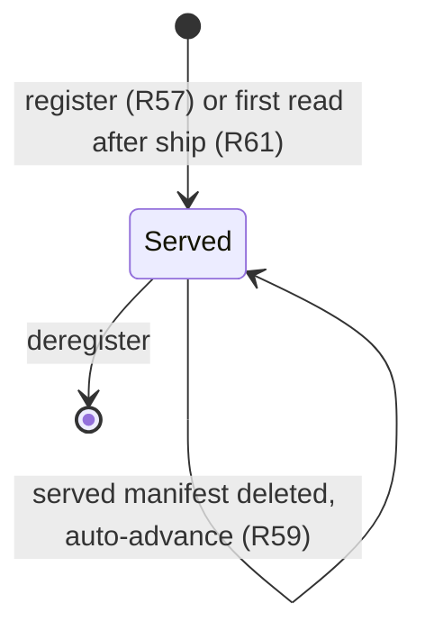
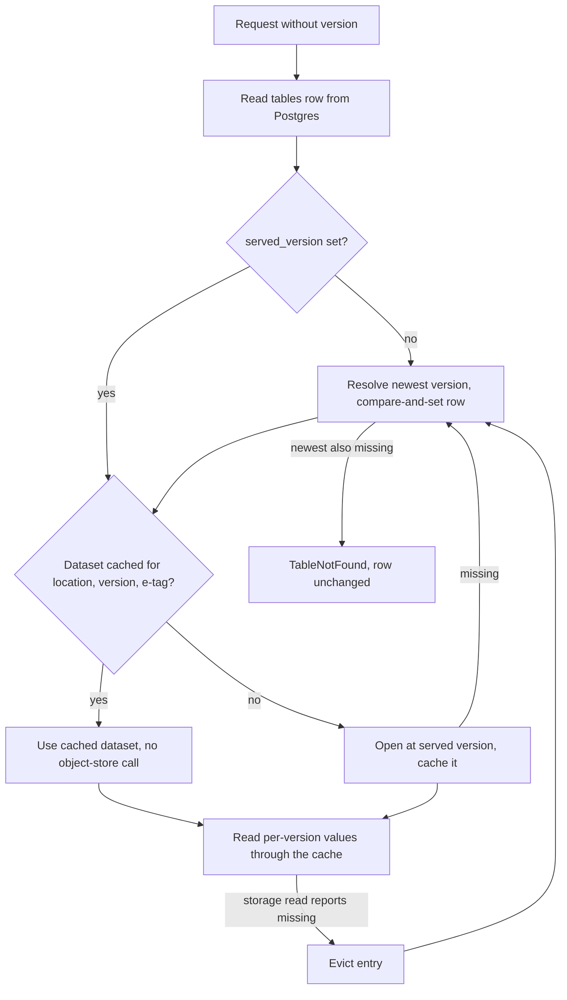

# Version-Pinned Metadata Cache - Plan

## Goal Capsule

- **Objective:** Viewing a table version the catalog has already served costs no repeated object-store work. Every instance agrees on which version is "latest". The service's memory stays within its Cloud Run instance.
- **Means:** The catalog records a served version per table in Postgres (KTD1) and caches opened datasets and every per-version result in each instance's Lance session cache under one memory budget (KTD2, KTD3, KTD4).
- **Product authority:** This contract. It supersedes the statement in `ARCHITECTURE.md` that Lance read routes open the dataset on every request and cache nothing. On product behavior the R-IDs win; on mechanism the KTDs win.
- **Execution profile:** One change set, committed and pushed directly to `main` (no pull request), as the requester directed.
- **Stop conditions:** Stop if Lance 14.0.2 cannot hold an opened `Dataset` in its session cache with a measured size, or if the counting check in U4 shows a warm unversioned request still reaches object storage and no in-crate fix exists.
- **Open blockers:** None.

---

## Product Contract

Product Contract preservation: restructured, no scope change. R59 and AE20 now say a missing served version is detected by the next request that reads the table's storage, and AE22 now covers only the routes tied to a single version. Both match R62 (version lists stay live) and R66 (no object-store request on a warm read), which the earlier wording contradicted.

### Summary

Each registered table has a served version recorded by the catalog. Every unversioned read, from the UI or a spec client, answers for that version until a refresh or re-registration advances it. Per instance, the catalog keeps opened datasets and every per-version result in Lance's session cache under one memory budget. A repeat view of a served version therefore does no repeated object-store work. Tags, branches and version lists stay live.

### Problem Frame

Today every Lance-backed route reads the table's newest manifest, then recomputes what it shows. That includes `get_table_stats` and column storage, which both read every data file's metadata, and the storage route, which lists the whole table prefix. A Lance version never changes once written, so this work repeats with identical results on every view. The repetition was not prompted by a measured slowdown; it is structural.

Memory is also unbounded in practice. The service builds `Session::default()`, whose metadata cache alone defaults to 1 GiB, inside a 1Gi Cloud Run instance that also hosts a 512 MB SQL memory pool. Caching more without a budget would turn that into out-of-memory crashes.

"Latest" is the one thing that is not immutable. Lance commits land directly in object storage, so the catalog has no signal when the newest version changes. Each instance resolving it independently could disagree with the others.

### Key Decisions

- **The catalog records the served version in Postgres; Lance stays authoritative for each version's contents.** (session-settled: user-directed — chosen over a per-table refresh counter that each instance re-resolves from Lance: only a recorded version number makes every instance serve exactly the same version.) Governs R56, R60, R72.
- **"Latest" advances only on an explicit refresh or re-registration, with no maximum age.** (session-settled: user-directed — chosen over resolving latest on every request, and over a refresh plus a maximum age: the user accepted that an unrefreshed table stays at its last served version.) Governs R57, R58.
- **The served version applies to every caller, spec clients included.** (session-settled: user-directed — chosen over limiting the cached "latest" to the UI: one meaning of "latest" across all routes.) A writer committing directly to Lance does not see that commit through the catalog until a refresh or re-registration. Governs R56.
- **A refresh can be triggered only by a catalog route or by re-registration; the UI has no refresh control.** (session-settled: user-directed — chosen over a refresh control on the table page.) Governs R57, R58, R64.
- **Values that change without a new version stay live; values tied to one version are cached; the storage listing is snapshotted for the served version.** (session-settled: user-directed — chosen over snapshotting everything at refresh and over keeping everything except per-version values live.) Governs R62, R67.
- **Versions newer than the served one are listed and readable on request.** (session-settled: user-directed — chosen over hiding them or refusing reads until a refresh.) Governs R63.
- **A served version that no longer exists advances automatically.** (session-settled: user-directed — chosen over returning an error until someone refreshes.) Cleanup spares only the manifest that is newest when it runs, plus tagged ones, so this happens in normal operation, not just in edge cases. Governs R59.
- **Cached results live in each instance's memory only.** (session-settled: user-directed — chosen over storing expensive per-version results and the storage snapshot in Postgres: no schema migration and no stored derived data, at the cost of recomputing once per instance.) Governs R65, R67.
- **The cache extends Lance's own session cache instead of adding a catalog response cache.** (session-settled: user-directed — chosen over a separate catalog response cache, and over adding version-keyed UI caching: one cache and one budget, shared with Lance's own reads.) Governs R65, R66, R68.
- **One data-statistics computation per version is shared by `get_table_stats` and column storage.** (session-settled: user-directed — chosen over leaving the duplicate computation and over merging both into one catalog route: the spec route stays intact and does no repeated work.) Governs R65.
- **Data sources follow the order: spec namespace APIs, then catalog routes built on Lance library APIs, then object-store listing as a last resort.** (session-settled: user-directed — chosen over writing custom routes first: standard behavior comes before custom work.) Governs R70.
- **Lance crates are pinned exactly to 14.0.2.** Cargo reads a bare `"14.0.2"` as "14.0.2 or any newer 14.x", so the existing declarations alone do not hold the version. Governs R71.

### Requirements

**Served version**

- R56. Every registered table has one served version. Any read that names no version, from any caller and on any route including SQL, answers for the served version.
- R57. Registering a table, in create or overwrite mode, sets its served version to the newest version at the registered location.
- R58. A catalog refresh operation advances a table's served version to the newest version and reports both the previous and the new served version.
- R59. When the served version's manifest no longer exists, the next request that reads the table's storage at that version advances the served version to the newest version and records it, as a refresh would.
- R60. Once a refresh, registration or automatic advance completes, every instance answers unversioned reads with the new served version.
- R61. Tables registered before this ships start with their newest version as the served version.

**Live data and newer versions**

- R62. Tags, branches, the version list and the timeline are read fresh on every request.
- R63. Versions newer than the served version appear in the version list and the timeline, and any route reads them when they are requested by number. The UI marks them as newer than the served version.
- R64. The Versions tab's "current" badge marks the served version.

**Caching**

- R65. On each instance, every value tied to one table version is computed at most once and shared across routes and concurrent requests. Such values are identified by location, version and manifest identity. They include detailed describe metadata, schema, fragment statistics, column storage, the index listing, and each version's manifest and transaction.
- R66. An unversioned request for a served version that is already cached on the instance makes no object-store request.
- R67. Each instance lists the table location once per served version, and lists it again when the served version changes.
- R68. One configurable memory budget bounds everything this cache holds, including Lance's index cache. Its default fits a 1Gi instance alongside the SQL memory pool. A full budget evicts entries and never crashes the instance.
- R69. Cached data never outlives its dataset. A dataset recreated at the same location, or a table re-registered to another location, never receives cached values from the earlier dataset.

**Lance crate usage**

- R70. Every read of table state goes through the `lance` crate, including the catalog's own cache entries, SQL and the storage listing. The catalog never parses manifests or data files itself.
- R71. Every Lance crate the workspace names directly is pinned to exactly 14.0.2 (`lance-namespace-reqwest-client` stays at its own 0.13.0).

**Documentation**

- R72. `ARCHITECTURE.md`, `AGENTS.md` and the `PostgresNamespace` doc comment state the new model: Lance is authoritative for each version's contents, the catalog decides which version is current, and per-version values are cached under the budget in R68.

### Acceptance Examples

- AE18. **Covers R56, R63.** **Given** a table served at v10, **when** a writer commits v11 directly to Lance and no refresh happens, **then** `describe_table` with no version reports v10, `list_table_versions` includes v11, describing v11 by number succeeds, and the UI marks v11 as newer than served.
- AE19. **Covers R58, R60.** **Given** two instances serving v10, **when** a refresh on instance A advances the table to v12, **then** the next unversioned request on instance B answers for v12.
- AE20. **Covers R59.** **Given** a table served at v10, **when** cleanup deletes the v10 manifest after v12 is committed, **then** the next unversioned request that reads the table's storage, on any instance without v10 cached, answers for v12, and later requests keep serving v12 without another refresh.
- AE21. **Covers R57, R69.** **Given** a table served at v5 from location L1, **when** it is re-registered in overwrite mode at location L2, **then** its served version is L2's newest version, and no value cached for L1 is returned for it.
- AE22. **Covers R65, R66.** **Given** an instance that has already served v10 of a table, **when** detailed describe, table stats, column storage, the index listing and the storage route are requested again for that table without a version, **then** none of them makes an object-store request or recomputes data statistics.

### Success Criteria

- On a warm instance, viewing the same served version again reads no data-file metadata and no manifests. Lance cache-hit statistics or object-store I/O counters show this. (R65, R66)
- An unversioned request on a warm instance makes no object-store call to find "latest". (R56, R66)
- The cache has an explicit, configurable memory budget that fits the 1Gi instance next to the SQL pool, and filling it does not crash the instance. (R68)
- After a refresh, every instance serves the same "latest" for a table. (R60)

### Scope Boundaries

- No refresh control in the UI, and no display of when a table was last refreshed.
- No maximum age on the served version.
- No storage of computed results or storage snapshots in Postgres, and no cache shared between instances.
- No HTTP cache headers and no version-keyed frontend query caching.
- No change to which spec operations the catalog implements. Refresh is a catalog route because the spec has no such operation.
- Not built: detecting a dataset that was deleted and recreated at the same location without a refresh or re-registration. A warm instance cannot notice it without the object-store call R66 forbids. A refresh or re-registration records the new manifest identity and clears the problem.
- Not built: making the cheap describe report the served version. Cheap describe stays a Postgres-only read and keeps its current response.

### Dependencies / Assumptions

- The refresh route has the same access rules as the other catalog routes. No route in the service authenticates today.
- Lance 14.0.2's session cache API (`Session::file_metadata_cache`, the `CacheKey` trait, `get_or_insert_with_key` coalescing concurrent loads) stays as verified; the R71 pin holds it.
- Opening a dataset at a known version always sends one HEAD request for the manifest before the session cache is consulted. Datasets with V1 manifest naming skip the manifest cache entirely. R66 therefore depends on reusing opened datasets rather than reopening them (KTD2).
- The SQL pool limit (512 MB) times its concurrency limit (2) already exceeds the 1Gi instance in the worst case. The cache budget default (KTD4) is sized against typical, not worst-case, SQL use.

### Sources / Research

- `catalog-store/src/namespace.rs:133`, `:155`, `:174-182`, `:285-313`: the "never cached" doc comment, `Session::default()`, the single dataset-open funnel and its error mapping.
- `catalog-store/src/namespace.rs:186-219`, `:759-810`: the two `calculate_data_stats` callers.
- `catalog-store/src/namespace.rs:224-269`: the storage listing.
- `catalog-store/src/timeline.rs:45-98`, `catalog-store/src/sql.rs:91`, `:212`: timeline and SQL version handling.
- `catalog-store/src/namespace.rs:632-716`, `:741`: registration (opens the dataset to validate it) and deregistration.
- `ARCHITECTURE.md:50-92`, `AGENTS.md:3-9`, `README.md:28-53`, `docs/FRONTEND.md:35`, `:105`: text R72 and U7 amend.
- `project.toml:15-18`, `catalog-api/src/config.rs:61`: 1 CPU and 1Gi per instance, and the 512 MB SQL memory pool.
- `frontend/src/lib/query.ts:7`, `frontend/src/lib/catalog-queries.ts:31-41`: 30 s default `staleTime`; table query keys carry no version.
- lance 14.0.2: `session.rs:124-143`, `:335`, `:350-354` (explicit budgets, public file-metadata cache, defaults), `dataset.rs:212`, `:216` (6 GiB index and 1 GiB metadata defaults), `dataset.rs:218-250` (`Dataset` is a cheap `Clone` of `Arc`s), `dataset.rs:883-899` and `dataset/builder.rs:895-921` (manifest open path), `dataset/statistics.rs:21-34` (`DataStatistics` has no derives), `dataset/cleanup.rs:787`, `:809` (which manifests cleanup deletes), `index.rs:3825-3832` (index metadata cached by version and e-tag).
- lance-core 14.0.2: `cache/mod.rs:107-135`, `:327`, `:486` (`CacheKey`, key prefixes, coalescing `get_or_insert_with_key`), `cache/quick.rs:32`, `:138` (size-weighted eviction), `lib.rs:14` (`deepsize`, not re-exported by `lance`).
- lance-table 14.0.2: `format/manifest.rs:38-39` (`Manifest` derives `DeepSizeOf`), `io/commit.rs:908-915`, `:1079-1095` (version resolution sends a HEAD; V1 fallback).
- lance-io 14.0.2: `object_store.rs:846-857` (`io_stats_snapshot`, `io_stats_incremental`).
- lance-namespace 14.0.2 `namespace.rs`: no operation refreshes a catalog's view of a table's latest version.

---

## Planning Contract

### Key Technical Decisions

- KTD1. **Two nullable columns on `tables` record the served version and its manifest e-tag.** A new migration `0003` adds them. Every request reads them from the table row it already fetches and never keeps them in instance memory, which is what makes R60 hold across instances. A NULL served version resolves on first read through the same path as an automatic advance, which is how R61 is met: a migration cannot open datasets. Registration fills both columns from the open it already makes to validate the location. Governs R56, R57, R60, R61.
- KTD2. **Opened datasets are cached in Lance's session metadata cache, keyed by location, version and manifest e-tag.** An unversioned read builds the key from the Postgres row it already fetches, so a warm hit opens nothing and contacts no object store (R66). A miss opens through `DatasetBuilder` at that version and stores the result. Explicit-version reads open first, then reuse or fill the same entry under the e-tag the open reports. The entry's size is the manifest's `DeepSizeOf` estimate plus a fixed overhead. The e-tag in the key keeps a recreated or relocated dataset from reusing an old entry (R69).
- KTD3. **The catalog's own per-version values are custom cache entries under the same key scheme.** These are data statistics, fragment row counts, the deleted-row count and the storage snapshot. Each is computed through `get_or_insert_with_key`, which coalesces concurrent loads. Each value is a catalog-owned type with a `DeepSizeOf` implementation, because Lance's `DataStatistics` derives nothing. The storage snapshot's key uses the served version, so R67 holds without extra bookkeeping. Lance's own manifest, transaction and index-metadata caches stay as they are. Governs R65, R67.
- KTD4. **One setting, `CATALOG_CACHE_MEMORY_LIMIT_MB` (default 256), is split three to one between Lance's metadata and index caches.** `Session::new` takes two separate budgets and defaults them to 1 GiB and 6 GiB. The setting reaches the session through a `PostgresNamespace` builder method, following `with_top_level_allowlist`, because `CatalogConfig` only reaches the routes. Eviction is by estimated size, so a full cache drops entries rather than growing. Governs R68.
- KTD5. **Refresh and automatic advance update the served version with a compare-and-set in Postgres.** Refresh writes the newest version unconditionally. An automatic advance writes only if the row still holds the version and e-tag it found missing. An automatic advance that loses the compare-and-set rereads the row and continues with the winner's value. Refresh does not touch `updated_at`, which keeps meaning "re-registered". Governs R58, R59, R60.
- KTD6. **"Missing" means Lance returned `NotFound`, `VersionNotFound` or `DatasetNotFound` while opening the served version or reading any of its files (manifest, data, deletion or index files).** Cleanup deletes unreferenced data files as well as old manifests, so a warm instance learns of the deletion from a failed data read. The catalog then evicts that version's cache entries, resolves the newest version, and retries the request once at it. If the newest version also fails as missing, the request returns `TableNotFound` and the row stays unchanged, which preserves today's 404 for a vanished dataset. A missing explicit version returns `TableVersionNotFound` and never advances anything. Governs R59.
- KTD7. **Live routes start from the served dataset handle and list from there.** The version list, timeline, tags and branches call Lance's listing APIs, which see every version regardless of which one is open. Versions above the served one are opened with `checkout_version`. Governs R62, R63.
- KTD8. **Refresh is `POST /catalog/v1/table/{id}/refresh`, returning the previous and new served versions.** It sits in `catalog_router` beside the existing catalog routes and has their access rules. An unknown table returns 404. A dataset that no longer exists returns `TableNotFound` and leaves the row unchanged. Governs R58.
- KTD9. **`lance`, `lance-namespace`, `lance-index` and a new direct `lance-core` dependency are declared `=14.0.2`.** `lance-core` is needed for `deepsize`, which `lance` does not re-export. Governs R70, R71.

### High-Level Technical Design

How an unversioned read resolves its dataset:

The cache layout inside Lance's session metadata cache, all under a prefix per dataset location:

| Entry | Key | Value | Filled by |
| --- | --- | --- | --- |
| Opened dataset | version, e-tag | `Dataset` handle, weighed by manifest size | every open (KTD2) |
| Data statistics | version, e-tag | bytes on disk per field id | `get_table_stats`, column storage |
| Fragment row counts | version, e-tag | sorted physical rows per fragment | `get_table_stats` |
| Deleted-row count | version, e-tag | count | detailed describe |
| Storage snapshot | served version, e-tag | bytes and objects per category | storage route |
| Manifest, transaction, index metadata | Lance's own keys | Lance's own values | Lance |

### Assumptions

- The `IoStats` counters on a dataset's object store count HEAD and LIST requests as well as reads. If they do not, U4's warm-read check wraps the object store through Lance's store-wrapper hook instead.
- A cached `Dataset` is `Send + Sync` and safe to share across requests, since it is a `Clone` of `Arc`s with no interior mutability the catalog touches.

### Sequencing

U1 first (pins and the new dependency). U2 and U3 then in either order. U4 needs U2 and U3. U5 needs U4. U6 and U7 last, in either order.

---

## Implementation Units

### U1. Pin Lance crates exactly

- **Goal:** Hold every Lance crate at 14.0.2 and add the direct `lance-core` dependency the cache values need.
- **Requirements:** R70, R71. KTD9.
- **Dependencies:** None.
- **Files:** `Cargo.toml`, `catalog-store/Cargo.toml`, `Cargo.lock`.
- **Approach:** Change `lance`, `lance-namespace` and `lance-index` to `=14.0.2` in the workspace dependencies and add `lance-core = "=14.0.2"`. The lockfile should not move any Lance crate.
- **Test scenarios:** Test expectation: none -- dependency declaration only; the workspace build proves it.
- **Verification:** The workspace builds and `Cargo.lock` still resolves every Lance crate to 14.0.2.

### U2. Served version in Postgres

- **Goal:** Record and maintain each table's served version and e-tag.
- **Requirements:** R56, R57, R58, R59, R60. KTD1, KTD5, KTD6.
- **Dependencies:** U1.
- **Files:** `catalog-store/migrations/0003_served_version.sql`, `catalog-store/src/namespace.rs`, `catalog-store/tests/namespace.rs`.
- **Approach:**
  1. Add the migration with both nullable columns and a leading comment, following `0002_table_catalog_facts.sql`.
  2. Add both columns to `TABLE_COLUMNS` and `TableRow`.
  3. In `register_table`, capture version and e-tag from the validation open and write them in both the create and overwrite statements.
  4. Add a store method that resolves the newest version and writes it with compare-and-set (refresh writes unconditionally, automatic advance only from the observed old value), returning previous and new versions.
- **Patterns to follow:** `register_table`'s single-statement upsert, `db_error` and `on_foreign_key` error mapping.
- **Test scenarios:**
  - Register creates a row whose served version equals the dataset's newest version.
  - Overwrite to a new location replaces served version and e-tag with the new location's values (AE21).
  - Refresh after one append moves the served version from v1 to v2 and reports both.
  - Refresh with no new commits reports the same version as previous and new.
  - Refresh of an unregistered table returns `TableNotFound`.
  - Refresh after the dataset directory is removed returns `TableNotFound` and leaves the row unchanged.
  - Two concurrent automatic advances from the same old version leave one consistent served version.
- **Verification:** Postgres-backed tests pass with `CATALOG_REQUIRE_DB_TESTS=1`.

### U3. Session budget and configuration

- **Goal:** Bound the Lance session by one configurable budget.
- **Requirements:** R68. KTD4.
- **Dependencies:** U1.
- **Files:** `catalog-api/src/config.rs`, `catalog-api/src/main.rs`, `catalog-store/src/namespace.rs`, `README.md`.
- **Approach:**
  1. Read `CATALOG_CACHE_MEMORY_LIMIT_MB` in `AppConfig` with the existing `positive_env` and MB-conversion pattern.
  2. Add a `PostgresNamespace` builder method that rebuilds the session with the split budgets.
  3. Add the variable to the README environment table.
- **Patterns to follow:** `SqlConfig::from_env`, `with_top_level_allowlist`.
- **Test scenarios:**
  - The default budget is 256 MB when the variable is unset.
  - A zero or non-numeric value is rejected at startup, like the SQL limits.
- **Verification:** Config unit tests pass, and the service starts with and without the variable set.

### U4. Version-keyed cache and served-version reads

- **Goal:** Route every unversioned read through the served version, reuse opened datasets, and compute each per-version value at most once per instance.
- **Requirements:** R56, R59, R61, R62, R63, R65, R66, R67, R69, R70. KTD1, KTD2, KTD3, KTD6, KTD7.
- **Dependencies:** U2, U3.
- **Files:** `catalog-store/src/cache.rs` (new), `catalog-store/src/lib.rs`, `catalog-store/src/namespace.rs`, `catalog-store/src/timeline.rs`, `catalog-store/src/sql.rs`, `catalog-store/tests/namespace.rs`.
- **Approach:**
  1. Define the cache keys and catalog-owned value types in `cache.rs`, each keyed under a per-location prefix.
  2. Replace `open_table` and the direct `open_registered` call in detailed describe with one open path that takes the row and an optional version. With no version it uses the served version, the cached dataset and the missing-version handling of KTD6.
  3. Move `calculate_data_stats`, fragment row counting, deleted-row counting and the storage listing behind cache entries. `column_storage`, `storage_footprint` and `get_table_stats` read from them and report the served version.
  4. Switch the live routes and SQL to the new open path, keeping their listing behavior (KTD7). SQL's `@vN` keeps using `checkout_version`.
- **Execution note:** Start with a failing test that counts object-store requests on a warm unversioned read, then make it pass.
- **Patterns to follow:** `open_registered` error mapping, `READ_CONCURRENCY` streams in `get_table_stats`, `timeline.rs` as an inherent-impl module.
- **Test scenarios:**
  - After one detailed describe, a second detailed describe, `get_table_stats`, column storage, index listing and storage make zero object-store requests (AE22).
  - `get_table_stats.total_bytes` equals the sum of column-storage bytes, and the second call does not recompute data statistics.
  - After an append without refresh, unversioned describe and stats report the old served version, `list_table_versions` includes the new version, and describing the new version by number succeeds (AE18).
  - After an append and a refresh, every unversioned route reports the new version (AE19, single instance).
  - Two namespaces sharing one Postgres schema but separate sessions both serve the refreshed version on their next unversioned read (AE19 across instances).
  - Removing the served version's manifest after a newer commit makes the next unversioned read on a fresh session serve the newer version and record it (AE20).
  - On a warm session holding the served version, deleting that version's data files after a newer commit makes the next unversioned SQL query evict the entry, advance, and return the newer version's rows in the same request.
  - A row with NULL served version resolves to the newest version on first read and records it (R61).
  - Removing the whole dataset directory still returns `TableNotFound` from describe, version list, column storage, storage and timeline.
  - Re-registering a table to a new location never returns column storage computed for the old location (AE21).
  - Requesting a version number that does not exist returns `TableVersionNotFound` and leaves the served version unchanged.
  - A session with a tiny budget still answers every route correctly after evicting entries.
- **Verification:** Postgres-backed store tests pass, including the rewritten vanished-dataset test.

### U5. Refresh route and REST behavior

- **Goal:** Expose refresh as a catalog route and align REST tests with served-version semantics.
- **Requirements:** R56, R58, R63. KTD8.
- **Dependencies:** U4.
- **Files:** `catalog-api/src/rest.rs`, `catalog-api/tests/rest.rs`.
- **Approach:** Add `POST /table/:id/refresh` to `catalog_router` with a serialized response of previous and new versions. Update the module and router comments that call the catalog routes read-only. Rewrite the SQL time-travel test so an unversioned query reads the served version before refresh and the newer one after it.
- **Patterns to follow:** `column_storage` handler and response struct; `status_for` error mapping.
- **Test scenarios:**
  - `POST /catalog/v1/table/{id}/refresh` after an append returns 200 with the old and new versions.
  - Refresh of an unknown table returns 404 with the spec error code.
  - Unversioned SQL after an append and before refresh counts the served version's rows. `@vN` for the new version counts the new rows. After refresh, unversioned SQL counts the new rows.
  - The vanished-dataset REST test still returns 404 with code 4 on every route it checks.
- **Verification:** REST tests pass with Postgres required.

### U6. UI markers for served and newer versions

- **Goal:** Show which version is served and which listed versions are newer.
- **Requirements:** R63, R64.
- **Dependencies:** U4.
- **Files:** `frontend/src/lib/table-metadata.ts`, `frontend/src/lib/table-metadata.test.ts`, `frontend/src/components/table/versions-tab.tsx`, `frontend/src/components/table/sql-panel.tsx`.
- **Approach:** Add a pure helper that classifies a version against the served version. Use it in the Versions tab to keep the "current" badge on the served version and add a "newer than served" badge. Rename the SQL picker's default option from "Latest" to "Served", take its number only from detailed describe's version, and drop the fallback to the first listed version, which after R63 can be newer than served. Show plain "Served" with no number while that version is unknown.
- **Patterns to follow:** existing helpers and tests in `frontend/src/lib/table-metadata.ts`.
- **Test scenarios:**
  - A version equal to the served version classifies as served.
  - A version above it classifies as newer.
  - A version below it classifies as older.
  - An unknown served version classifies nothing as served or newer.
- **Verification:** `bun run test` and `bun run build` pass in `frontend/`.

### U7. Documentation

- **Goal:** Make the docs describe the served-version model and the cache.
- **Requirements:** R72.
- **Dependencies:** U4, U5.
- **Files:** `ARCHITECTURE.md`, `AGENTS.md`, `README.md`, `docs/FRONTEND.md`, `catalog-store/src/namespace.rs`.
- **Approach:** Replace "nothing is cached" and "Lance manifests stay authoritative for table state" with the R72 model. Add the refresh route to the route lists. Note that SQL and the UI default to the served version. Point `AGENTS.md`'s current plan at this file.
- **Test scenarios:** Test expectation: none -- documentation only.
- **Verification:** No doc or doc comment still states that Lance details are never cached or that unversioned reads return the newest commit.

---

## Verification Contract

| Gate | Command | Proves |
| --- | --- | --- |
| Format | `cargo fmt --all --check` | Rust formatting |
| Lint | `cargo clippy --workspace --all-targets -- -D warnings` | No new warnings |
| Rust tests | `CATALOG_TEST_DATABASE_URL=… CATALOG_REQUIRE_DB_TESTS=1 cargo test --workspace --all-targets` | U2, U3, U4, U5 scenarios, Postgres-backed tests not skipped |
| Frontend tests | `bun run test` in `frontend/` | U6 helper |
| Frontend build | `bun run build` in `frontend/` | Type check and bundle |

---

## Definition of Done

- Every unit's test scenarios exist and pass under the gates above, with Postgres-backed tests running, not skipped.
- The warm-read test in U4 shows zero object-store requests for the AE22 routes.
- `Cargo.lock` resolves every Lance crate to 14.0.2 and every direct Lance dependency is declared `=14.0.2`.
- No code path still opens the newest version for an unversioned read, except resolution during registration, refresh and automatic advance.
- Docs no longer claim Lance details are never cached.
- Code from abandoned approaches is removed from the diff.
