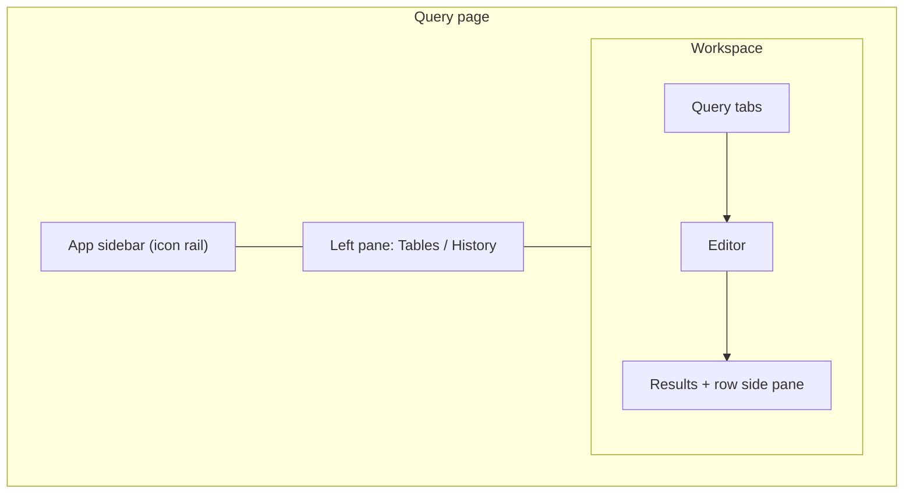
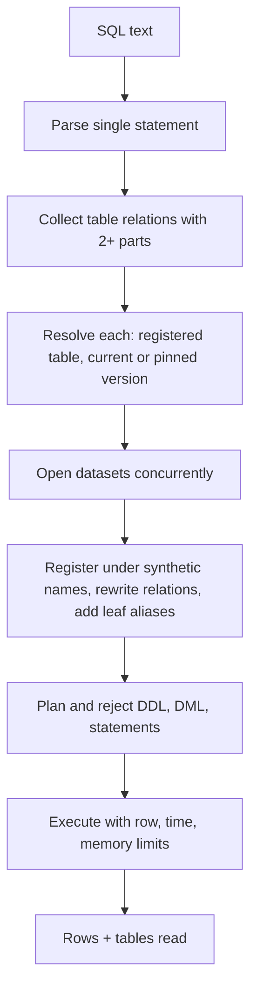

# Global SQL Query Page - Plan

## Goal Capsule

- **Objective:** Catalog users can write one read-only SQL query that joins or compares any registered tables, from a workspace that belongs to the whole catalog rather than to a single table.
- **Means:** Move the table page's SQL editor into a top-level Query page, in the style of Athena and BigQuery workspaces (KTD1, KTD7).
- **Product authority:** The Product Contract below. Saved or shared queries are not active scope.
- **Execution profile:** One pull request. Server and UI ship together because the old single-table route is removed, and no stated project rule requires a split.
- **Stop conditions:** Stop and report if DataFusion's planner cannot plan a statement whose table names were rewritten as KTD1 describes, or if the sqlparser visitor API is unavailable through the existing `lance` dependency.
- **Open blockers:** None.

---

## Product Contract

Product Contract unchanged from the brainstorm; its deferred questions are resolved in KTD4, KTD9, and KTD10.

### Summary

A top-level Query page lets a query read and join any registered table by its full catalog path, for example `"a"."b"."events"`. The page has a table browser and history pane on the left, query tabs above the editor, and results below. Today's result features carry over. The table page loses its SQL tab and gains a "Query this table" action that opens the Query page pre-filled.

### Problem Frame

SQL runs only inside one table's page, and the server exposes only that table to the query. Users cannot join tables, compare tables, or explore the catalog with SQL. Anyone who wants cross-table answers has no place in the UI to get them.

### Key Decisions

- **Tables are named by full catalog path, quoted.** No current-namespace setting and no user-chosen aliases. (session-settled: user-directed — chosen over a current-namespace setting and explicit aliases: a path has the same meaning in every pasted or history query, with no UI state behind it.) Governs R3.
- **The table page's SQL tab is removed**, not kept alongside the global editor. (session-settled: user-directed — chosen over keeping both: one SQL surface to maintain.) Governs R13.
- **The table browser is a dedicated pane, and the app sidebar collapses to its icon rail on the Query page.** (session-settled: user-directed — chosen over reusing the app sidebar's tree and over a pane next to an open sidebar: the editor gets the room, and the sidebar's click-to-navigate meaning stays intact.) Governs R9, R14.
- **Browser, history, and multiple query tabs ship with the page; saved queries do not.** (session-settled: user-directed — chosen over also shipping saved queries: those need new server-side storage.) Governs R9, R11, R12.
- **The single version picker is dropped.** One picker cannot serve several tables, so versions are pinned per table in the SQL text. Governs R4.

### Requirements

**Page and navigation**

- R1. The app navigation has a top-level Query entry that opens the Query page without requiring a table.
- R2. The Query page shows query tabs, an editor, and results, with the editor/results split resizable as in today's SQL tab.

**Querying**

- R3. A query can read any registered table by its full catalog path, with every namespace segment and the table name double-quoted, and can join, union, or nest subqueries across tables.
- R4. A plain table path reads the table's current version; `"a"."b"."events@v12"` reads version 12. One query can mix versions of the same or different tables.
- R5. Queries stay read-only: statements that write or change schema are rejected, and no registered dataset or media object is modified.
- R6. Row, time, memory, and concurrency limits apply per query, not per table. Cancel stops waiting as it does today.
- R7. A reference to an unregistered table or a missing version fails the query with an error naming that path.

**Results**

- R8. Results keep today's behavior: column types, nested values as JSON, binary as hex, row count, elapsed time, truncation notice, resizable columns, CSV download, the row side pane, and playback of blob and URL values. Blob columns are recognized from column metadata alone, since no single table is in context.

**Table browser and history**

- R9. A left pane switches between Tables and History. Tables shows the namespace and table tree with name search. Clicking a table inserts its quoted full path at the cursor, and expanding a table lists its columns with types.
- R10. The editor keeps table and column completion, now over catalog tables by full path.
- R11. Each run is recorded in the browser with its query text and time. Selecting an entry loads it into the active tab. History is per browser and is not shared.

**Query tabs**

- R12. The user can open, switch between, and close query tabs. Each tab keeps its own query text and results, and tabs survive navigating elsewhere in the app and back.

**Table page and layout**

- R13. The table page has no SQL tab. It has a "Query this table" action that opens a new query tab pre-filled with `SELECT * FROM "<full path>" LIMIT 20`, leaving existing tabs unchanged.
- R14. While the Query page is open the app sidebar shows as its icon rail, and the user can re-expand it.

### Acceptance Examples

- AE1. **Covers R3, R4.** Given tables `"a"."b"."events"` and `"a"."b"."users"`, when the user runs a join of `"a"."b"."events"` with `"a"."b"."users@v3"`, the result joins events at its current version with users at version 3.
- AE2. **Covers R7.** When a query names a table path that is not registered, no results show and the error names that path.
- AE3. **Covers R12, R13.** Given two query tabs with results, when the user chooses "Query this table" on a table page, a third tab opens pre-filled and the first two keep their text and results.
- AE4. **Covers R12.** When the user leaves the Query page for a table page and returns, every tab still shows its query and results.

### Success Criteria

- A user can join two tables from different namespaces without opening either table's page.
- No result feature from today's SQL tab is lost.

### Scope Boundaries

**Deferred for later**

- Saved, named, server-stored queries shared across users.
- History shared across browsers or users.
- Short table names via a current-namespace setting, and catalog-level table aliases defined outside the SQL text. Ordinary SQL `AS` aliases inside a query are supported.

**Outside this work**

- Writing, deleting, or committing to any registered dataset.

**Considered and not built**

- A cap on tables per query: the time, memory, and concurrency limits already bound the cost, and a cap would narrow R3. Evidence to change the call: a single query that exhausts instance memory despite the pool limit.
- Persisting open tabs across a page reload: history already keeps recent query text, and tab text was never persisted before.
- A redirect for old `?tab=sql` links: the table route's search validation drops an unknown tab value and opens Overview (`frontend/src/routes/tables.$tableId.tsx`).
- A cap on open query tabs: no demonstrated harm at the default 1,000-row result cap, and users close tabs. Evidence to change the call: reported sluggishness with many tabs holding large results.

### Dependencies / Assumptions

- The service has no per-table access control; the platform's IAP guards the whole service (`README.md`). Cross-table querying exposes nothing that the single-table route does not already expose.
- The catalog already enumerates all tables and namespaces for the sidebar search (`list_all_tables` in `catalog-store/src/namespace.rs`, `frontend/src/components/global-search.tsx`), so the table tree needs no new listing capability.
- Tables are registered under a namespace, never at the root (`catalog-store/src/namespace.rs`, "tables must be registered under a namespace"), so every catalog path has at least two parts.

---

## Planning Contract

### Key Technical Decisions

- KTD1. **Table references are resolved by rewriting the parsed statement, not through DataFusion's catalog hierarchy.** DataFusion names stop at `catalog.schema.table`, while namespaces nest to any depth. The server parses the statement, finds each table relation that has two or more name parts, opens that table, registers it in the query's session under a synthetic single-part name, and rewrites the relation to it. Governs R3, R4, R7.
  - Parsing uses the session's DataFusion parser. The rewrite unwraps its statement wrapper, recurses into `EXPLAIN`, and covers `COPY` sources, so every table name the planner would see goes through it.
  - Segments are taken as written, so unquoted segments are not lowercased.
  - A one-part name is never a catalog path: it passes through when it matches a CTE alias declared in the statement, and otherwise fails with a message that asks for a full path.
  - Table functions (relations with arguments) are left alone.
  - A rewritten relation takes the leaf as written (for example `events@v12`) as its alias unless the user gave one or another relation in the statement would get the same default alias. In that case it keeps its synthetic name as its qualifier, so same-named tables from different namespaces stay distinguishable.
  - Column references and qualified wildcards written with a table's full path are rewritten to that relation's qualifier, so `"a"."b"."events".id` keeps resolving.
  - Two references to the same table and version share one registered table and keep their own aliases.
- KTD2. **One session per query, holding only the tables the statement names.** Tables open concurrently under the existing `READ_CONCURRENCY` bound and inside the single query time limit. Memory pool, disabled spilling, and the plan check that rejects DDL, DML, and statements are unchanged in effect (R5, R6). The plan check runs on the plan built from the rewritten statement.
- KTD3. **A plain reference reads the table's current version and keeps the stale-current recovery.** When a read fails because a current version's files were removed by cleanup, the table advances to its newest version and the query runs once more, as `read_row` in `catalog-store/src/namespace.rs` does for one table today. Pinned versions never advance anything. Governs R4.
- KTD4. **The response lists every table read.** `tables` carries each table's id and version in order of first appearance, replacing the single `version` field, and the request no longer accepts `version`. The results footer shows `v<N>` when exactly one table was read and `<n> tables` otherwise, with the `path@vN` list as the tooltip. Resolves the footer question; governs R8.
- KTD5. **Errors name the path as written.** Every per-reference failure carries the quoted path from the SQL, with any `@vN`, rather than the storage location or `$`-joined id the existing open helpers use. An unregistered path or a deleted dataset is `TableNotFound` (404), a missing pinned version is `TableVersionNotFound` (404), and a one-part name is `InvalidInput` (400). The UI's existing error titles already map all three (`errorTitle` in `frontend/src/components/table/sql-panel.tsx`). Governs R7.
- KTD6. **The route is `POST /catalog/v1/sql`, replacing `POST /catalog/v1/table/:id/sql`.** The bundled UI is the only caller in the repo, so the old route is removed rather than kept as an alias. Governs R3.
- KTD7. **The Query page stays mounted once visited**, the pattern table pages use (`kept` state in `frontend/src/routes/tables.$tableId.tsx` and `ActiveContext`). The root layout renders it hidden off the `/query` route, so tabs, text, results, and an in-flight query survive navigation without a module-level store. Governs R12.
- KTD8. **The sidebar shows its rail on `/query` without changing the stored `nav-collapsed` preference.** The root passes a prop; expanding on this page lasts until the user leaves it. Governs R14.
- KTD9. **History is a capped list in `localStorage`.** Fifty entries, newest first; running text identical to an existing entry moves that entry to the top with the new time instead of adding a row. Open tabs are not persisted. Resolves the persistence and cap question; governs R11, R12.
- KTD10. **Completion schema is nested by path and fills columns on demand.** Table paths come from the list-all query (`useAllTableIds`). Columns load through the existing table-describe query when a table is expanded in the browser, inserted, or named in the active tab's text, debounced and through the shared describe limiter. Resolves the column-loading question; governs R9, R10.
- KTD11. **"Query this table" navigates to `/query?table=<joined id>`.** The page opens one pre-filled tab per navigation carrying the parameter and then clears it, so reloads do not open duplicates and the link is shareable. A first mount that carries the parameter seeds the initial tab with the pre-filled text instead of adding a second tab beside an empty one. Governs R13.

### High-Level Technical Design

Directional shape of one query on the server.

### Risks & Dependencies

- The rewrite depends on the sqlparser AST that DataFusion 54 re-exports (`visitor` feature already enabled in `datafusion-sql`). Keep the rewrite in one function with tests so a DataFusion upgrade fails loudly there.
- A table whose own name ends in `@v<N>` is read as that exact table first, as `VersionedTable` does today; only an unregistered leaf is then tried as a version pin.
- Cross-table joins are heavier than single-table reads, and the per-instance concurrency default is 2 (`CATALOG_SQL_MAX_CONCURRENT`). Throttling already returns a clear error; no change planned.
- Quoted nested-path completion in CodeMirror's SQL language is unverified. U6 carries a fallback.
- The old single-table route returns 404 to any caller outside this repository (the service's users reach it behind IAP). The pull request description names the break; no alias is kept (KTD6).

---

## Implementation Units

### U1. Multi-table query engine

- **Goal:** One query reads any registered tables by full path, with versions pinned per reference, behind the existing limits.
- **Requirements:** R3, R4, R5, R6, R7. KTD1, KTD2, KTD3, KTD4, KTD5.
- **Dependencies:** none.
- **Files:** `catalog-store/src/sql.rs`, `catalog-store/src/namespace.rs` (crate-private helpers for opening a table at a version and recovering a stale current version), `catalog-store/src/lib.rs` (export the new result type), `catalog-store/tests/sql.rs` (new), `catalog-store/tests/current_version.rs`.
- **Approach:**
  1. Replace `PostgresNamespace::query_sql(id, sql, version, limits)` with a call that takes only the SQL and limits; the result carries `tables` (id and version per table read) instead of one `version`.
  2. Parse one statement with the session's DataFusion parser and walk it with the sqlparser visitor over table factors, expressions, and qualified wildcards, unwrapping the DataFusion statement wrapper (including `EXPLAIN` and `COPY` sources), so function calls and CTE aliases can be told apart from table paths (KTD1).
  3. Resolve each path to a registered table (exact leaf first, then a `@v<N>` pin on the leaf), wrapping every failure with the path as written (KTD5). Open the distinct (table, version) pairs concurrently, register them under synthetic names, and rewrite relations, default aliases, and path-qualified references as KTD1 states.
  4. Build the plan from the rewritten statement, reject DDL, DML, and statements on that plan, then run with the existing row cap and memory pool inside one time limit.
  5. On a stale-current failure, advance the affected tables and run once more (KTD3); keep `sql_error` mapping for everything else.
  6. Remove `VersionedTable` and the single-table session once nothing uses it.
- **Execution note:** Port `current_version_advances_when_cleaned_up` and the existing rejected-statement cases to the new call first; they pin the behavior to keep.
- **Patterns to follow:** `table_provider`, `encode_rows`, and `sql_error` in `catalog-store/src/sql.rs`; `read_row` retry in `catalog-store/src/namespace.rs`; Postgres-backed test setup in `catalog-store/tests/support/mod.rs`.
- **Test scenarios:**
  - Covers AE1. Two tables in different namespaces join on a key and return rows from both; one reference pins `@v<N>` of the second.
  - A table at four segments (`a/b/c/events`) is readable by its four-part path.
  - Unquoted path segments resolve with their case preserved.
  - `SELECT events.id FROM "a"."b"."events"` resolves through the default leaf alias; a user alias replaces it; `"a"."b"."events".id` and `"a"."b"."events".*` resolve too.
  - Tables named `events` in two namespaces join in one query: it runs, and each side's columns resolve through its full path.
  - The same table at its current version and at a pinned older version, each aliased, compare in one query.
  - A CTE named like a one-part name does not trigger the full-path error; a bare unknown one-part name returns `InvalidInput` mentioning the full-path form.
  - A table function call such as `range(3)` is not treated as a catalog path.
  - `EXPLAIN SELECT` over a full path returns a plan.
  - Covers AE2. An unregistered path returns `TableNotFound`, a deleted dataset returns `TableNotFound`, and a missing pinned version returns `TableVersionNotFound`; each message contains the quoted path as written.
  - `CREATE TABLE`, `INSERT`, `DROP TABLE`, and `COPY "a"."b"."events" TO` a file are rejected and no file is written; the `COPY` case names a registered table, so the plan check is what rejects it.
  - A plain reference to a table whose current version was cleaned up advances to the newest version and returns rows (ported from the current-version test).
  - `SELECT 1` with no table returns `tables` empty.
- **Verification:** `cargo test -p catalog-store` passes with a Postgres URL, and the ported current-version test still passes.

### U2. REST route

- **Goal:** `POST /catalog/v1/sql` runs a global query and returns the tables it read.
- **Requirements:** R3, R4, R5, R6, R7. KTD4, KTD5, KTD6.
- **Dependencies:** U1.
- **Files:** `catalog-api/src/rest.rs`, `catalog-api/tests/rest.rs`, `README.md`.
- **Approach:**
  1. Register the route and remove `/table/:id/sql`; the handler keeps the empty-SQL check, the concurrency slot, and the elapsed-time field.
  2. Drop `version` from the request; respond with `tables` as an array of `{id, version}` where `id` is the segment array.
  3. Replace the SQL block of the REST test (the section under "Read-only SQL over the table's leaf name") with full-path equivalents.
  4. Update the README route row and its description: full paths, `@v<N>` pins, `tables` in the response, limits unchanged.
- **Patterns to follow:** the existing `run_sql` handler and `error(status, code)` assertions in `catalog-api/tests/rest.rs`.
- **Test scenarios:**
  - Typed columns, Arrow JSON values, `row_count`, and `elapsed_ms` for a one-table query, with `tables` listing the table and its current version.
  - `max_rows` truncation sets `truncated` and `row_count`.
  - Statements that write or change schema return 400 with code 13.
  - Plain reads see the current version until refresh, and `@v<N>` pins read that version, as the existing assertions check.
  - Covers AE2. An unregistered path returns 404 code 4; a missing version returns 404 code 11; a registered table whose dataset was deleted returns 404 code 4; each message contains the quoted path.
  - A query over two tables returns `tables` with both entries in order of first appearance.
  - An empty `sql` returns 400 code 13.
- **Verification:** `cargo test -p catalog-api` passes; `rg 'table/.*/sql'` finds no remaining caller of the old route outside historical release notes.

### U3. Client data layer

- **Goal:** The pure logic for table paths, query tabs, and history exists and is tested in isolation.
- **Requirements:** R3, R10, R11, R12, R13. KTD9, KTD10, KTD11.
- **Dependencies:** none.
- **Files:** `frontend/src/lib/sql.ts`, `frontend/src/lib/query-tabs.ts` (new), `frontend/src/lib/query-history.ts` (new), and tests `frontend/src/lib/sql.test.ts`, `query-tabs.test.ts` (new), `query-history.test.ts` (new).
- **Approach:**
  1. In `lib/sql.ts`, add a path quoter that quotes each segment with `quoteIdent`, a default-query builder that takes segment arrays, and a function that finds known table paths inside query text for KTD10. The single-table helpers stay until U4 removes them with their last caller.
  2. `query-tabs.ts` holds a pure reducer: open (optionally pre-filled), close (activates a neighbor, never leaves zero tabs), activate, set text. Tab titles are `Query <n>` with a counter that never reuses a number.
  3. `query-history.ts` holds add (dedupe by text, cap 50, newest first), load, and save against `localStorage` with the failure tolerance `preferences.ts` uses.
- **Patterns to follow:** `useStoredState` storage handling in `frontend/src/lib/preferences.ts`; existing table-driven cases in `frontend/src/lib/sql.test.ts`.
- **Test scenarios:**
  - A path with a quote in a segment quotes and escapes each segment.
  - The default query for `["a","b","events"]` is `SELECT * FROM "a"."b"."events" LIMIT 20`.
  - Text naming two known table paths returns both; a quoted path that is not a known table is ignored.
  - Closing the last remaining tab opens a fresh one; closing the active tab activates a neighbor; opened tab numbers never repeat.
  - Opening a pre-filled tab leaves other tabs' text untouched.
  - Adding a duplicate text moves it to the top with the new time; the 51st entry drops the oldest; unreadable stored data loads as empty.
- **Verification:** `bun run test` passes in `frontend/`.

### U4. Query page and table-page cutover

- **Goal:** The Query page exists with one working query pane, the sidebar shows its rail there, and the table page no longer has a SQL tab.
- **Requirements:** R1, R2, R6, R8, R12, R13, R14. KTD4, KTD5, KTD7, KTD8, KTD11.
- **Dependencies:** U2, U3.
- **Files:** `frontend/src/routes/query.tsx` (new), `frontend/src/routeTree.gen.ts` (regenerated), `frontend/src/routes/__root.tsx`, `frontend/src/components/app-sidebar.tsx`, `frontend/src/components/query/query-page.tsx` (new), `frontend/src/components/query/query-pane.tsx` (new), `frontend/src/components/query/result-grid.tsx` (new, result components moved), `frontend/src/components/table/sql-panel.tsx` (removed), `frontend/src/routes/tables.$tableId.tsx`, `frontend/src/lib/api.ts`, `frontend/src/lib/schemas.ts`, `frontend/src/lib/sql.ts`, and tests `frontend/src/lib/api.test.ts`, `schemas.test.ts`, `sql.test.ts`.
- **Approach:**
  1. Client: `runSql(sql, signal)` posts to `/catalog/v1/sql`, and `sqlResponseSchema` replaces `version` with `tables`. Remove the single-table helpers `defaultQuery`, `versionRef`, and `blobColumnNames`, and the by-name branch of `isBlobColumn`, with their tests: column metadata is the only blob signal (R8).
  2. Move the result components (`ResultGrid`, `RowPane`, `VideoClip`, `SaveClip`, cell styling, elapsed formatting, error titles) out of `sql-panel.tsx` and drop their `blobColumns` parameter. Re-base their scroll model on the new page: the Query page is a flex column filling the main region, each pane's results area is its own vertical scroll container, the grid header sticks to that container, and the row pane positions against it. The `PINNED` height math and the `--tabs-h` and `--sticky-top` offsets go. Below `md`, the editor keeps a viewport-based height and results scroll inside the remaining height.
  3. `QueryPane` is the old panel minus the version picker and per-table props: editor with Run, Cancel, a Clear button shown when text is non-empty, collapse, resize, and the footer rule of KTD4. The CSV file name is `query-results.csv`. The empty-results text carries over the read-only and row-cap statement, and explains that tables are referenced by full quoted path (`"namespace"."table"`) and that `"table@v12"` reads a version.
  4. `QueryPage` renders one `QueryPane` for now (U5 adds tabs). The root renders it once visited and hides it off `/query`, giving that route a full-height, non-scrolling main region without the centered padded container. On `/query` the breadcrumb reads `Catalog / Query` with Query as `aria-current="page"`. `/query` itself renders nothing.
  5. Add a Query entry to the expanded sidebar and to the rail, styled active with `aria-current="page"` on `/query`, and show the rail on `/query` per KTD8.
  6. Remove the `sql` tab, its lazy import, icon, `blobColumns` memo, and the `versions` and `currentVersion` props it alone used from the table route, and add the "Query this table" action beside the table name, linking to `/query?table=<joined id>`. Make the route's search validation set an unknown `tab` explicitly unset, so a stale `?tab=sql` opens Overview instead of leaking through from the parent search.
  7. Delete `sql-panel.tsx` once nothing imports it.
- **Execution note:** Move the result components with `git mv` plus edits so review sees them as moved, not rewritten.
- **Patterns to follow:** keep-alive and `ActiveContext` in `frontend/src/routes/tables.$tableId.tsx`; `useStoredState("nav-collapsed", …)` in `frontend/src/components/app-sidebar.tsx`.
- **Test scenarios:**
  - `sqlResponseSchema` accepts `tables` and rejects a response without it; `runSql` posts only the SQL to the new route.
  - Browser smoke (the frontend has no component test harness). Covers R1. The Query entry opens the page from a table page and from the namespace list, shows as active, and the breadcrumb reads `Catalog / Query`.
  - Browser smoke. Covers R14. On `/query` the sidebar is the icon rail; clicking the rail expands it; leaving and returning to a table page shows the sidebar as the user last stored it.
  - Browser smoke. Covers R8. A query returning a blob column plays back in the row pane; CSV download contains the returned rows; a long result scrolls inside the results area with the header pinned.
  - Browser smoke. Covers AE4. A result and a running query survive going to a table page and back.
  - Browser smoke. The table page shows no SQL tab, and opening `?tab=sql` lands on Overview.
- **Verification:** `bun run test` and `bun run build` pass (type-check included); a browser run of the scenarios above.

### U5. Query tabs, history recording, and pre-fill

- **Goal:** Several independent queries on the page, a recorded history, and the "Query this table" hand-off.
- **Requirements:** R2, R11, R12, R13. KTD7, KTD9, KTD11.
- **Dependencies:** U4.
- **Files:** `frontend/src/routes/query.tsx`, `frontend/src/components/query/query-page.tsx`, `frontend/src/components/query/query-tab-strip.tsx` (new), `frontend/src/components/query/query-pane.tsx`.
- **Approach:**
  1. `QueryPage` owns the tab reducer state and renders a tab strip above one `QueryPane` per tab, all mounted and hidden when inactive so each keeps its text, results, and in-flight run.
  2. The strip is a horizontally scrollable `role="tablist"` with the active tab scrolled into view and a new-tab button after the scroll area. A running tab shows a spinner and a tab whose last run failed shows an error dot. The close button is a sibling of the tab button, labeled like "Close Query 2", with the tooltip "Stops the running query" while that tab runs; Left and Right arrows move between tabs. Closing a tab aborts its in-flight query.
  3. The page starts with one empty tab. When it first mounts with the `table` search parameter, that tab holds the pre-filled text. When the page is already mounted, the parameter opens one new pre-filled tab, and either way the route then clears the parameter with a replace navigation (KTD11).
  4. A run records history before the request starts (KTD9).
- **Patterns to follow:** the run, cancel, and abort-on-unmount handling in the current `SqlPanel`.
- **Test scenarios (browser smoke):**
  - Covers AE3. With two tabs holding results, "Query this table" opens a third pre-filled tab and the first two are unchanged.
  - A first visit through `/query?table=...` shows one pre-filled tab and no empty sibling.
  - Reloading `/query?table=...` after the parameter was cleared opens no extra tab.
  - Running the same text twice leaves one history entry at the top.
  - Closing the tab that holds a running query stops waiting for it; a tab running in the background shows its spinner, and one that failed shows the error dot.
- **Verification:** `bun run build`; browser run of the scenarios above.

### U6. Table browser, history list, and completion

- **Goal:** The left pane lets users find tables, insert paths, see columns, and reload past queries; the editor completes paths and columns.
- **Requirements:** R9, R10, R11. KTD10.
- **Dependencies:** U5.
- **Files:** `frontend/src/components/query/left-pane.tsx` (new), `frontend/src/components/query/table-browser.tsx` (new), `frontend/src/components/query/history-list.tsx` (new), `frontend/src/components/namespace-tree.tsx` (parameterize the table leaf), `frontend/src/components/sql-editor.tsx`, `frontend/src/components/query/query-page.tsx`, `frontend/src/lib/catalog-queries.ts`.
- **Approach:**
  1. The pane is 16rem wide on desktop with a collapse control whose state persists through `useStoredState`, and it switches between Tables and History. The editor-beside-results and row-pane thresholds follow the workspace width rather than the viewport, so the pane does not squeeze them.
  2. Tables reuses the lazy namespace tree. A table row has a chevron that expands it to its columns with types and a label that inserts the quoted path at the cursor; a column row inserts its quoted name. After an insert the editor regains focus with the cursor after the text, or at the end of the document if it was never focused. A non-empty name box replaces the tree with a flat list of matching full paths, as `GlobalSearch` shows them. The table list and column describe show loading and error rows, and an empty search shows "No tables match".
  3. History rows show the first non-empty line of the query on one line with the full text as the tooltip and the time beneath it (honoring the timezone preference); an empty list reads "No queries run yet". Selecting a row replaces the active editor's content through a CodeMirror transaction, so undo restores the previous draft.
  4. The editor's schema becomes a nested object built from the table paths, with columns filled by KTD10's triggers.
  5. Below the `md` breakpoint a toggle opens the pane as an overlay drawer, like the mobile navigation.
- **Execution note:** Check quoted nested-path completion in the browser first. If `@codemirror/lang-sql` cannot complete across quoted segments, offer each table's full quoted path as one completion option instead; the fork stays inside this unit.
- **Patterns to follow:** `TreeChildren` and `TableLeaf` in `frontend/src/components/namespace-tree.tsx`; `GlobalSearch` index use in `frontend/src/components/global-search.tsx`.
- **Test scenarios (browser smoke):**
  - Covers R9. Clicking a table label inserts its quoted full path at the cursor; the chevron lists columns with types; the name box narrows the list; an empty catalog shows an empty state.
  - Covers R10. Typing `"a"."b".` offers that namespace's tables; after a table's path appears in the text, its column names complete.
  - Covers R11. Selecting a history entry replaces the active tab's text, does not run it, and Ctrl/Cmd-Z restores the previous text.
  - The pane collapses and re-expands, and keeps that choice after a reload.
  - The pane is reachable on a narrow window as a drawer.
- **Verification:** `bun run build`; browser run of the scenarios above.

### U7. Documentation

- **Goal:** Docs describe the global route and Query page, per the repository rule that route and UI changes update docs in the same PR.
- **Requirements:** All.
- **Dependencies:** U1–U6.
- **Files:** `README.md`, `docs/FRONTEND.md`, `ARCHITECTURE.md`.
- **Approach:**
  1. `docs/FRONTEND.md`: replace the SQL tab section with a Query page section and update the table page's tab count and list.
  2. `ARCHITECTURE.md` SQL section: describe per-query sessions holding only referenced tables, full-path names, and unchanged limits.
  3. Confirm the README route row from U2 and that no other doc names the removed route.
- **Test expectation:** none -- documentation only.
- **Verification:** `rg 'table/:id/sql|table/\{id\}/sql'` returns only historical release notes.

---

## Verification Contract

| Check | Command | Applies to |
|---|---|---|
| Format | `cargo fmt --all --check` | U1, U2 |
| Lint | `cargo clippy --workspace --all-targets -- -D warnings` | U1, U2 |
| Rust tests | `CATALOG_TEST_DATABASE_URL=$DATABASE_URL CATALOG_REQUIRE_DB_TESTS=1 cargo test --workspace --all-targets`, with the local Postgres from `AGENTS.md` | U1, U2 |
| Frontend build | `cd frontend && bun install && bun run build` | U3–U6 |
| Frontend tests | `cd frontend && bun run test` (CI does not run these) | U3 |
| Browser smoke | Build the UI, run `cargo run --bin catalog-api` against the local Postgres, register two Lance tables in different namespaces, then exercise AE1–AE4 and the U4–U6 scenarios | U4–U6 |

## Definition of Done

- Every Requirement R1–R14 and Acceptance Example AE1–AE4 holds in the browser smoke run.
- All commands in the Verification Contract pass.
- `/catalog/v1/table/:id/sql`, `VersionedTable`, `SqlPanel`, the per-table version picker, and the single-table helpers `defaultQuery`, `versionRef`, and `blobColumnNames` are gone, with no leftover references.
- README, `docs/FRONTEND.md`, and `ARCHITECTURE.md` match the shipped behavior.
- No scaffolding, throwaway scripts, or abandoned-attempt code remain in the diff.

---

## Sources / Research

- `catalog-store/src/sql.rs` (`VersionedTable`, `run_on`, `sql_error`): the single-table session this work replaces.
- `catalog-store/src/namespace.rs` (`read_table`, `read_row`, `open_table`, `list_all_tables`, `READ_CONCURRENCY`): table opening, current-version recovery, and the all-tables listing.
- `catalog-api/src/rest.rs` (`run_sql`) and `catalog-api/tests/rest.rs`: the route and the SQL assertions to port.
- `frontend/src/components/table/sql-panel.tsx`, `frontend/src/components/sql-editor.tsx`, `frontend/src/routes/tables.$tableId.tsx`: the UI being moved, and the keep-alive pattern to reuse.
- `frontend/src/components/app-sidebar.tsx`, `frontend/src/components/namespace-tree.tsx`, `frontend/src/routes/__root.tsx`: navigation and layout the page sits in.
- `docs/FRONTEND.md` (SQL tab) and `ARCHITECTURE.md` (SQL): current behavior and limits.
